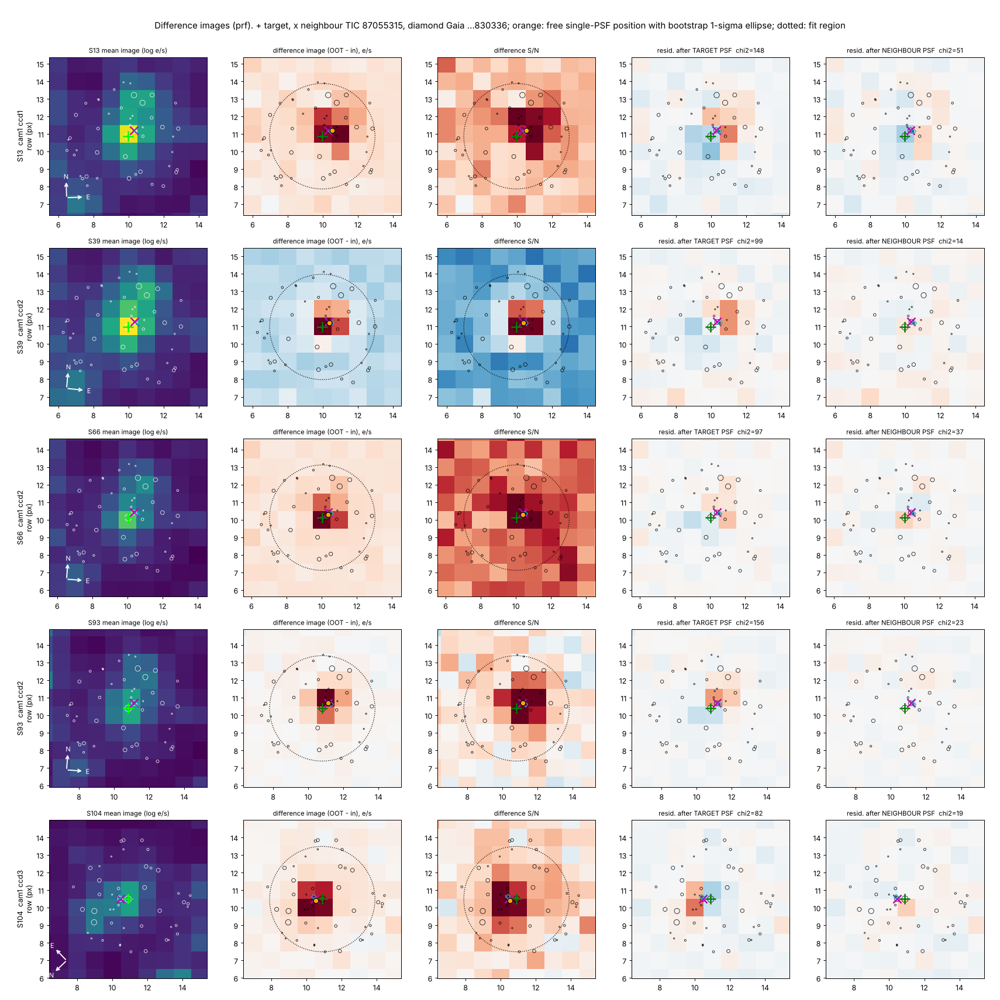

# Searching TESS for undiscovered planets and stars

An independent search of public NASA TESS data, run by Claude Code in October 2026, inspired by the
[TIC 4206066 Reddit post](../tic4206066/). The goal was to find a planet or star nobody had reported.

> **Correction (2026-10-12).** An earlier version of this page presented TIC 87055304 as a new planet candidate.
> An adversarial re-examination showed that the transit comes from a neighbouring star 9.3″ away (TIC 87055315), and
> that two errors in our own vetting had hidden this. That neighbour is an uncatalogued eclipsing binary, not a planet
> host. Full account: [`tic87055304/`](tic87055304/). All TRICERATOPS numbers on this page have been recomputed after
> fixing the second error, a runner bug.

## Results

- **158,263 stars searched.** These were dwarf and subgiant stars in TESS Sectors 104 and 105, observed April to June
  2026. The 39,999 stars seen in both sectors were also searched with the two sectors combined, which reaches longer
  periods (5–25 days).
- **The search found real signals.** 528 of its candidates matched planets, TOIs, pipeline alerts or eclipsing binaries
  that were already known.
- **No new planet candidate survives.**
  - The strongest one, TIC 87055304 (a 0.4 % flat-bottomed dip every 4.136 days), is withdrawn. Three independent
    pixel-level analyses and a model-free referee test place the source on TIC 87055315, 9.3″ away. Every test points
    there: nominal significances are 6–10σ, and the most conservative single tests still give ≥ 3.9σ.
  - On TIC 87055315 the eclipse is 2.1 % deep, and the companion is 2.6 R_Jup (0.27 R☉): an M dwarf in an
    uncatalogued eclipsing binary, not a planet. See [`tic87055304/`](tic87055304/).
- **No new planet could be validated.** 190 planet-like signals were tested for recurrence in every other TESS sector
  from 2018 to 2026, and every one that recurred was vetted. Six repeating signals are new, but none is a planet:
  - TIC 87055304, the neighbouring eclipsing binary above;
  - TIC 320686138, an eclipsing binary (secondary eclipse found);
  - TIC 155991187, 72651793, 245976814 and 158159741, most likely eclipsing binaries or blends.
- **62 eclipsing or close binary stars, characterised for the first time.** Each is a star with a companion star whose
  orbital period and eclipses had never been published. A 63rd, TIC 87055315, was found by tracing the TIC 87055304
  signal to it; it is described separately in [`tic87055304/`](tic87055304/).
  - 59 were previously only flagged as "eclipse-like" in an unvetted neural-network list of about 873,000 TESS stars
    ([Kostov et al. 2025](https://ui.adsabs.harvard.edu/abs/2025ApJS..279...50K), table 2), which gives no period, depth or vetting.
  - 2 (TIC 114787953 and TIC 100666720) are not in that list or any other catalogue checked.
  - The remaining one, TIC 351474229, is not in Kostov's list but has a Gaia binary solution.
  - In all, 4 systems (3 of them among the 59) already have Gaia binary solutions, so for them the binarity was known
    and only the eclipses are new.

  The accurate claim is therefore *first vetted confirmation and characterisation*, not first-ever detection.

## TIC 87055304: a planet candidate that turned out to be a neighbouring eclipsing binary

**What we first reported.** A flat-bottomed 0.4 % dip every 4.136 days on TIC 87055304 (T = 11.7), seen in five
sectors from 2019 to 2026. It had no odd/even difference, no secondary eclipse, flat Gaia radial velocities and no
catalogue entry. We called it the strongest planet candidate of the search.

**Why that was wrong.** A neighbour 9.3″ away (TIC 87055315, T = 13.5) shares every TESS aperture.
- Our quick centroid check was biased toward the target and could not separate the two stars. We also misread its
  error bars as excluding the neighbour "at more than 6σ".
- A bug in our TRICERATOPS runner hid every nearby-star scenario.

**What the re-examination found.** The user asked for an adversarial campaign. It found:
- **Independent PRF localisation** with injection calibration puts the source 0.66″ from the neighbour and 8.8″ from
  the target.
- **Simultaneous PSF photometry** of the two stars shows the neighbour dims and the target does not: 0.64 ± 0.36 ppt
  on the target, against ~4 ppt if it were the host.
- **A model-free pixel test** by an adversarial referee agrees.
- **No shared systematic.** The referee also ruled one out: WCS, registration, pointing jitter and timing.

**What the neighbour is.** TIC 87055315 is a 1.9 R☉ F/G turn-off star 1.3 kpc away. A 0.27 R☉ companion (2.6 R_Jup)
eclipses it by 2.1 % every 4.136 days, which makes it an M dwarf in an EBLM-type binary. A twin binary at twice the
period is excluded by the eclipse shape. It is in no catalogue we searched.

**Settling it.** One seeing-limited ground observation of a single eclipse would settle the host. The first
well-placed eclipses are in April–July 2027; times are in [`tic87055304/`](tic87055304/).

*Difference images for the five sectors (rows). A PSF at the target (fourth column) leaves structured residuals;
a PSF at the neighbour (fifth column) leaves noise.*

## Highlights among the binaries

**TYC 7034-792-1 (TIC 143042674): a Sun-like star with a small M-dwarf companion**

| | |
|---|---|
| Period | 5.044137 ± 0.000003 d |
| Primary eclipse | 2.2 % deep, flat-bottomed |
| Secondary eclipse | 870 ppm at phase 0.502 |
| Companion size | 0.138 star radii, about 0.20 solar radii (twice Jupiter's radius) |

- The secondary eclipse gives a TESS-band brightness temperature of about 2,900 K. That makes the companion a low-mass
  M dwarf of roughly 0.15–0.2 solar masses.
- Gaia DR3 independently measured the primary's radial velocity changing by about 35 km/s over 22 visits. That is
  what a stellar-mass companion on a 5-day orbit should produce; a planet would move the star by less than 0.5 km/s.

**TYC 8382-1377-1 (TIC 6598941): a hot-Jupiter look-alike**

- A flat-bottomed 1.7 % dip every 2.12 days on a 1.9 R☉ F star looks like a hot Jupiter at first.
- But the companion would be about 0.25 R☉ (2.4 R_Jup), and there is a 570 ppm secondary eclipse at exactly half
  phase. Gaia's 62 km/s radial-velocity range is what a 0.25 M☉ star on this orbit produces.

**TYC 7006-2246-1 (TIC 123267483): near-twin stars**

- 7.273221-day orbit, with 32–44 % and 28–32 % eclipses, timed over 387 orbits from 2018 to 2026.

**TIC 100666720: a pair of M dwarfs 122 pc away**

- 7.341134-day orbit, with alternating 6.4 % and 5.0 % eclipses that are consistent in every sector.
- Three more M-dwarf pairs were found later: TIC 343895671 (3.02 d, 31 % and 28 % eclipses), and TIC 212554303 and
  316096209, whose true orbits (1.198 d and 2.296 d) were also revealed by unequal alternate eclipses.
- The search first found half this period. Each sector's odd and even eclipses have different depths, which shows the
  true orbit is twice as long. TYC 9119-1863-1 (TIC 406279367) is a second case, with near-equal eclipses.
- Not in any catalogue checked.

**Eccentric orbits**

- TYC 8448-663-1 (TIC 139256801), 15.52-day orbit: secondary eclipse at phase 0.722.
- TIC 100378891, 11.20-day orbit: secondary at phase 0.357.
- Also eccentric:
  - CD−31 1060 (TIC 122543151), secondary at phase 0.452.
  - TYC 7000-227-1 (TIC 179677500), at 0.568.
  - TIC 217276354, at 0.526.
  - TYC 8341-933-1 (TIC 217648205), at 0.38; it also shows visible pulsations.

## All 62 binaries

Periods come from eclipse timing across 2018–2026. Depths are averages over pipelines, which dilute differently.
For every system the pixel check places the eclipse on the target, within 2.5σ of its catalogue position.
For 40 of the 62, no Gaia star within 42″ is bright enough to cause the eclipse.
Full numbers are in [`candidates/new_eclipsing_binaries.csv`](candidates/new_eclipsing_binaries.csv) and folded light curves
in [`candidates/final_figs/`](candidates/final_figs/).

| TIC | Other name | T mag | Period (d) | Primary | Secondary (phase) | Sectors | Type | Notes |
|---|---|---|---|---|---|---|---|---|
| 314677221 | - | 11.56 | 3.275130 | 44.4 % | 11.41 % (0.500) | 4 | detached | Gaia RV amplitude 150 km/s |
| 100378891 | 2MASS J20310324-5307568 | 11.99 | 11.20054 | 38.1 % | 8.37 % (0.357) | 5 | detached | eccentric (secondary at phase 0.357, e cos w ~ -0.22); found by the combined two-sector search |
| 146708570 | - | 11.49 | 4.732100 | 34.2 % | 22.60 % (0.500) | 5 | detached | Gaia RV amplitude 121 km/s; RUWE 15 |
| 123267483 | TYC 7006-2246-1 | 10.46 | 7.273221 | 31.8 % | 27.79 % (0.485) | 4 | detached | near-twin |
| 343895671 | - | 12.66 | 3.020022 | 31.4 % | 27.65 % (0.501) | 7 | detached | M-dwarf pair, near-twin |
| 217276354 | - | 11.52 | 6.89185 | 27.2 % | 28.70 % (0.526) | 3 | detached | near-twin; eccentric (secondary at phase 0.526); Gaia RV amplitude 116 km/s |
| 316096209 | SIPS J1840-4010 | 12.83 | 2.296088 | 24.9 % | 24.16 % (0.500) | 3 | detached | M-dwarf pair (3,100 K); odd and even eclipses differ in all 3 sectors, so the orbit is twice the search period; an equally bright star 3.2" away (T~12.8) cannot be separated by TESS, so either could be the eclipsing pair |
| 234968334 | UCAC2   4235460 | 11.93 | 7.685760 | 23.8 % | 9.23 % (0.500) | 5 | detached | Gaia RV amplitude 108 km/s; RUWE 37.9; found by the combined two-sector search |
| 139256801 | TYC 8448-663-1 | 10.69 | 15.523717 | 21.6 % | 16.10 % (0.722) | 7 | detached | highly eccentric (secondary at phase 0.722, e cos w ~ +0.35); found by the combined two-sector search |
| 80064194 | TYC 8394-1748-1 | 10.55 | 5.810694 | 19.1 % | 7.26 % (0.500) | 4 | detached |  |
| 76224662 | TYC 8750-903-1 | 11.13 | 4.93228 | 18.8 % | 5.20 % (0.500) | 7 | detached |  |
| 122543151 | CD-31  1060 | 9.95 | 7.483459 | 17.6 % | 10.61 % (0.452) | 4 | detached | eccentric; RUWE 4.4 (tertiary?) |
| 122203391 | - | 11.74 | 4.71438 | 17.3 % | 10.09 % (0.500) | 5 | detached | Gaia RV amplitude 108 km/s; RUWE 10.0 |
| 114917180 | - | 12.00 | 2.406130 | 13.9 % | 7.59 % (0.500) | 4 | detached |  |
| 142274982 | UCAC2  11682533 | 11.47 | 7.93719 | 12.7 % | 1.39 % (0.507) | 4 | detached |  |
| 122852877 | - | 11.16 | 3.053672 | 12.4 % | 11.55 % (0.500) | 5 | detached |  |
| 197958602 | [R97] GRB 790406 2 | 11.93 | 5.417814 | 11.3 % | 8.60 % (0.500) | 8 | detached | Gaia RV amplitude 180 km/s |
| 179677500 | TYC 7000-227-1 | 10.82 | 7.911417 | 11.1 % | 3.31 % (0.568) | 5 | detached | eccentric |
| 327599302 | - | 11.77 | 5.020329 | 10.8 % | 2.83 % (0.500) | 10 | detached | Gaia RV amplitude 142 km/s |
| 404124262 | UCAC2  10760330 | 11.45 | 7.59867 | 10.8 % | 0.83 % (0.505) | 5 | detached | flat-bottomed (total) primary eclipse; cool companion (secondary 8 % of primary); found by the combined two-sector search |
| 80453626 | UCAC4 227-000753 | 11.75 | 3.337312 | 10.2 % | 5.72 % (0.500) | 7 | detached | found by the combined two-sector search at twice its period (6.675 d; that search starts at 5 d) |
| 304444218 | - | 11.45 | 3.241675 | 10.1 % | 2.92 % (0.500) | 4 | detached |  |
| 218359654 | TYC 7892-1121-1 | 11.10 | 1.391544 | 9.3 % | 7.27 % (0.502) | 3 | detached | plx 0.85 mas: luminous primary (subgiant or giant?); RUWE 7.6 |
| 406279367 | TYC 9119-1863-1 | 11.27 | 3.125464 | 7.8 % | 7.47 % (0.500) | 8 | detached | near-equal eclipses; odd and even depths differ in all 8 sectors, so the orbit is twice the search period; Gaia RV amplitude 175 km/s |
| 156003824 | TYC 8027-291-1 | 11.64 | 4.969439 | 7.5 % | 0.63 % (0.502) | 6 | detached | cool companion (secondary 8 % of primary) |
| 372170356 | - | 11.72 | 2.835650 | 7.2 % | 1.31 % (0.500) | 7 | detached | Gaia RV amplitude 159 km/s; RUWE 10.5 |
| 143345010 | TYC 7940-1151-1 | 10.63 | 2.669561 | 7.0 % | 1.47 % (0.500) | 4 | detached | Gaia NSS solution exists (binarity known; eclipses new) |
| 180444443 | TYC 7001-246-1 | 11.19 | 2.497060 | 6.9 % | 1.05 % (0.502) | 6 | detached |  |
| 363482012 | - | 12.21 | 3.68671 | 6.7 % | 4.93 % (0.500) | 6 | detached | M dwarf (3,800 K) |
| 281740175 | UCAC4 155-000744 | 11.79 | 11.05219 | 6.3 % | 0.53 % (0.515) | 10 | detached | flat-bottomed (total) primary eclipse; cool companion; secondary at phase 0.514; RUWE 9.2; found by the combined two-sector search |
| 412733784 | - | 11.02 | 3.854711 | 6.2 % | 0.51 % (0.517) | 6 | detached | slightly eccentric (secondary at phase 0.517); RUWE 6.9 |
| 89040715 | TYC 8003-1087-1 | 11.02 | 4.621055 | 5.9 % | 3.31 % (0.502) | 4 | detached | RUWE 8.2 (tertiary?) |
| 304770656 | - | 11.86 | 3.16020 | 5.9 % | 0.73 % (0.489) | 5 | detached | flat-bottomed (total) primary eclipse; secondary at phase 0.489; Gaia RV amplitude 106 km/s |
| 100666720 | - | 13.39 | 7.341134 | 5.8 % | 0.14 % (0.117) | 4 | detached | M-dwarf pair, 122 pc; alternating 6.4 % / 5.0 % eclipses, so the orbit is twice the search period |
| 48939280 | - | 13.25 | 2.73651 | 5.5 % | 3.72 % (0.500) | 4 | detached | M-dwarf pair |
| 128677131 | - | 11.53 | 1.251952 | 5.4 % | 2.78 % (0.500) | 5 | detached |  |
| 212554303 | UCAC4 191-166535 | 11.89 | 1.198154 | 5.0 % | 4.68 % (0.500) | 6 | detached | M-dwarf pair; odd and even eclipses differ in all 6 sectors, so the orbit is twice the search period; an equally bright star 2.4" away (T~11.8) cannot be separated by TESS, so either could be the eclipsing pair |
| 217648205 | TYC 8341-933-1 | 10.54 | 7.61104 | 4.5 % | 0.31 % (0.382) | 6 | detached | eccentric (secondary at phase 0.38); pulsations visible; G=13.7 star 3.8" away cannot be separated by TESS |
| 90919279 | TYC 7914-380-1 | 11.73 | 7.392323 | 4.2 % | 1.45 % (0.512) | 4 | detached | slightly eccentric (secondary at phase 0.513); a T~13.5 star 5.1" away could produce the eclipse and cannot be separated by TESS; Gaia RV amplitude 126 km/s |
| 63594264 | TYC 7907-2230-1 | 11.38 | 1.813884 | 4.2 % | 0.60 % (0.500) | 3 | detached | eclipse 4.3 % deep in S13/S39 but 2.9 % in S104: dilution differs between sectors |
| 396957421 | TYC 8352-1599-1 | 10.94 | 6.329213 | 4.2 % | 1.20 % (0.500) | 6 | detached | neighbours at 7" (T~14.3) and 15" (T~12.1) could contribute; centroid within 2.0 sigma |
| 314203738 | - | 11.71 | 3.398441 | 4.1 % | 2.50 % (0.500) | 4 | detached | Gaia RV amplitude 149 km/s; RUWE 7.7 |
| 129032726 | TYC 7955-2777-1 | 11.97 | 3.350564 | 4.0 % | 1.78 % (0.492) | 3 | detached | RUWE 19.5 |
| 320327029 | TYC 8786-1621-1 | 10.55 | 4.440732 | 3.9 % | 0.70 % (0.500) | 6 | detached |  |
| 49617965 | TYC 7016-804-1 | 11.35 | 3.76520 | 3.7 % | 0.22 % (0.500) | 3 | detached | cool companion (secondary 6 % of primary); BLS first found 4x the period |
| 200247352 | - | 11.03 | 3.338011 | 3.7 % | 1.31 % (0.500) | 5 | detached |  |
| 197985960 | - | 11.74 | 3.329832 | 3.0 % | 2.45 % (0.500) | 7 | detached |  |
| 124358211 | - | 11.88 | 0.845550 | 2.9 % | 0.40 % (0.503) | 5 | detached | RUWE 13.2 |
| 278802197 | TYC 7999-451-1 | 11.79 | 1.061827 | 2.8 % | 1.35 % (0.502) | 4 | detached | Gaia NSS solution exists (binarity known; eclipses new) |
| 379508029 | - | 11.96 | 1.097569 | 2.5 % |  % () | 7 | detached | no secondary detected (< 0.04 %); the orbit could be twice this period if the two eclipses are identical; a T~14.2 star 3.9" away could also produce the eclipse |
| 143042674 | TYC 7034-792-1 | 10.69 | 5.044137 | 2.2 % | 0.09 % (0.502) | 2 | detached | G + M-dwarf companion (EBLM-like); Gaia RV amplitude 35 km/s |
| 217228307 | - | 11.89 | 0.8298 | 1.8 % | 0.33 % (0.487) | 5 | detached | out-of-eclipse modulation (spots or reflection); crowded field: 16 Gaia stars within 42" are bright enough to produce the eclipse |
| 6598941 | TYC 8382-1377-1 | 11.18 | 2.11961 | 1.7 % | 0.06 % (0.500) | 4 | detached | F star + low-mass companion (EBLM-like): flat-bottomed eclipse, companion ~0.25 solar radii; Gaia RV amplitude 62 km/s, as expected for a ~0.25 solar-mass companion (a planet would give < 1 km/s) |
| 261500541 | CD-66  2541 | 9.77 | 3.126963 | 1.6 % | 0.09 % (0.502) | 11 | detached | grazing; cool companion (secondary 5 % of primary) |
| 231286114 | TYC 8054-890-1 | 10.55 | 2.020458 | 1.3 % | 0.77 % (0.500) | 4 | detached |  |
| 115242114 | TYC 7527-529-1 | 11.52 | 3.935908 | 1.1 % | 0.17 % (0.500) | 5 | detached | RUWE 46, plx 0.16 mas (astrometry unreliable) |
| 33445288 | TYC 6431-1534-1 | 10.99 | 0.7986 | 4.2 % | 1.85 % (0.500) | 4 | contact/ellipsoidal | eclipses on top of ellipsoidal variation; Gaia NSS solution exists (binarity known; eclipses new); Gaia RV amplitude 176 km/s |
| 76440895 | - | 11.26 | 0.677319 | 3.0 % | 1.95 % (0.502) | 6 | contact/ellipsoidal | well-separated eclipses; grouped with close binaries only because P < 0.8 d; RUWE 11.5 |
| 351474229 | - | 11.92 | 0.8775 | 2.3 % | 2.76 % (0.492) | 6 | contact/ellipsoidal | sharp eclipse on top of ellipsoidal variation; the broad minimum at phase 0.49 is as deep (2.8 %) because the ellipsoidal dip adds to it; Gaia NSS solution exists (binarity known; eclipses new); not in Kostov+25 table 2; Gaia RV amplitude 243 km/s |
| 32398505 | TYC 7003-400-1 | 11.50 | 0.601493 | 2.0 % | 0.34 % (0.505) | 4 | contact/ellipsoidal |  |
| 114787953 | TYC 7951-1401-1 | 11.74 | 0.60577 | 1.0 % | 0.67 % (0.500) | 3 | contact/ellipsoidal | not in Kostov+25 table 2 |
| 71315603 | CD-44 14744 | 11.02 | 0.507699 | 0.6 % | 0.30 % (0.500) | 3 | contact/ellipsoidal |  |

## Planet-like signals that are probably not planets

Each of these is a real, repeating signal that is not in the TOI, CTOI or SPOC alert lists, or any variable-star
catalogue.

**TIC 155991187**

- **System:** a K dwarf about 150 pc away, in a triple-star system. It has a co-moving M-dwarf companion 8.2″ away, and
  Gaia's RUWE of 21 means it also has an unresolved close companion.
- **Signal:** a 12-hour period (0.5012110 d) with dips about 2.9 ppt deep, the same in 6 sectors from 2018 to 2026.
  Alternate dips match, there is no secondary eclipse, and there is no ellipsoidal variation (< 80 ppm).
- **Which star:** a directional pixel test disfavours the 8.2″ companion as the source (Δχ² ≈ 11).
- **TRICERATOPS (corrected):** false-positive probability 0.99, of which 0.34 is the 8.2″ companion. The most likely
  scenarios are a transit or eclipse on an unresolved companion of the target (0.39 and 0.20) and an eclipsing
  binary on the 8.2″ companion (0.20). In short, a stellar system hiding the source.

**TIC 72651793**

- **Signal:** P = 0.6345 d and 410 ppm, found independently in 3 sectors.
- **Against a planet:** alternate dips differ by 3.5σ, and the transit implies a star much denser than the target.
- **TRICERATOPS (corrected):** false-positive probability 0.92, of which 0.40 is nearby eclipsing binaries.

**TIC 245976814**

- **Signal:** P = 0.5070757 d, 1.1–1.5 ppt, consistent in 4 sectors from 2021 to 2026, on an F/G star (T = 11.6).
  Alternate dips match and there is no secondary eclipse.
- **TRICERATOPS (corrected):** false-positive probability 0.84, of which 0.81 is spread over many nearby stars in
  this crowded field; the on-target planet scenario gets 0.11. The earlier value (0.19) came from the buggy runner,
  which dropped all nearby-star scenarios.
- **But a directional pixel test points elsewhere.** In Sectors 39 and 66 the dip falls about 21″ south-east of the
  target, on a G = 15.3 star 16.6″ away that would need only a ~2 % eclipse to produce the whole signal.
  Sector 104 prefers the target, but overall the neighbour fits better (χ² 12.6 vs 19.6 for 6 degrees of freedom).
- **Verdict:** most likely an eclipsing binary on that neighbour.

**TIC 320686138** (G star, T = 11.8, [Fe/H] = +0.41)

- **Signal:** P = 11.91415 d, about 3,700 ppm, 9 transits in 5 sectors from 2019 to 2026. The dip is on target, and
  Gaia's radial velocities are constant.
- **Why it is not a planet:**
  - The 2.2-hour transit is nearly grazing.
  - TRICERATOPS (corrected) gives a false-positive probability of 0.98.
  - An independent review pointed to the phase-0.5 panel, and a closer look found a secondary eclipse of
    1,531 ± 155 ppm at phase 0.511, present in all 10 epochs.

**TIC 158159741** looked promising (P = 1.807 d, 1.7 ppt, on target), but its transit is V-shaped and nearly grazing.
A 3.6″ neighbour could produce it, and TRICERATOPS (corrected) gives a false-positive probability of 0.87.

Every other planet-like signal that recurred was ruled out. They were blends located 10–46″ off target, eclipsing
binaries (secondary eclipses, unequal alternate dips, grazing fits, companions larger than 2 R_Jup), distant giants
(24 of them), δ Scuti pulsation troughs, rotational variables, or dips too long or too short for the star. See
[`FINDINGS.md`](FINDINGS.md).

## Combined two-sector search

- **Input:** the 39,999 stars observed in both Sectors 104 and 105, searched with the sectors combined for periods of
  5–25 days. Orbit-gap edges were masked, and at least 3 transits and a red-noise S/N of 10 were required.
- **Candidates:** 410 after rescoring: 340 binary-like, 42 variable and 28 planet-like. After the known-signal and
  VizieR checks, 6 planet-like and 118 binary-like signals were new.
- **Planet-like:**
  - 4 were not recovered in any older sector.
  - 1 is an eclipsing binary at twice the period (alternate dips differ at 11σ).
  - 1 is TIC 320686138, an eclipsing binary with a 0.15 % secondary eclipse (see above).
- **Binary-like:** 53 passed the broad novelty check. 6 passed every cut and the visual review and are in the table
  above, including the two most eccentric systems.

## How it was done

| Step | What | Code |
|---|---|---|
| Targets | QLP target lists for S104/S105 with TIC v8.2 parameters. Kept T ≤ 12 stars with R ≤ 2.5 R☉, plus cool dwarfs to T ≤ 13.5 | `tic_mast_all.py`, `make_sample.py` |
| Light curves | MIT QLP `DET_FLUX`, quality-flagged points removed, binned to 10 min. Per-camera time windows hit by sector-wide systematics are found from thousands of stars and masked | `fetch_qlp.py`, `common_mode.py` |
| Search | Box least squares from 0.5 d to half the baseline. Isolated single events masked, best of the top 10 peaks by red-noise S/N, checks at 2× and 3× the period. Combined S104+S105 search for 5–25 d | `bls.py`, `run_search.py`, `run_search_multi.py` |
| Validation | Recovers known TOIs. Injection tests recover 96–99 % of signals with expected S/N > 25 on quiet stars | `val_known.py`, `inject.py` |
| Selection | Red-noise S/N ≥ 9, ≥ 3 transits, no dominant single event. Sorted into planet, eclipsing-binary and variable tracks using odd/even depths, secondary eclipse and phase-curve flatness | `select_cands.py`, `classify.py`, `driver.py`, `driver_multi.py` |
| Novelty | TOI, CTOI, NASA Exoplanet Archive, 341,351 SPOC TCEs, VSX, ASAS-SN (variables and EBs), Gaia DR3 EB and variability classes, Prša+22, Kostov+25, IJspeert+24, ATLAS, SuperWASP, Gao+25, WISE, Green+23 ellipsoidal candidates, SIMBAD, and every VizieR table within 15″ | `known.py`, `catalog_check.py`, `eb_triage.py` |
| Recurrence | Every other TESS sector of the star (SPOC 2-min, TESS-SPOC or QLP), searched near the period and compared with the same search at random periods | `stage2.py` |
| Vetting | Transit-model fit and stellar density, held-out sectors, TESScut difference imaging (including a directional test), Gaia neighbours, TRICERATOPS, ellipsoidal limits, Gaia RV/RUWE/NSS. Final depths from SAP or PDCSAP flux with a transit-masked detrend. For the final candidate: PRF localisation with injection calibration, simultaneous PSF photometry and a model-free pixel test (`tic87055304/analysis/`). `centroid.py` is retained, but it cannot separate stars within ~1 pixel | `vet.py`, `vet_report.py`, `vet_summary.py`, `centroid.py`, `offset_test.py`, `run_tri.py` |
| Binaries | Eclipse timing, primary and secondary depths, secondary phase, quality cuts, visual review of every fold | `eb_analysis.py`, `eb_select.py`, `eb_final.py`, `eb_merge.py`, `review_sheets.py`, `final_plots.py` |
| Independent review | Four adversarial reviews (GPT-5.5 three times, Gemini 3.1 Pro once) via OpenRouter, $1.30 total. They prompted the Kostov+25 catalogue check, the directional centroid test, better wording, fixes to two periods and the figure set, and the search that found TIC 320686138's secondary eclipse. The final candidate then went through a multi-agent adversarial campaign: independent investigators, each refereed, which found that the signal is on the neighbour and found the TRICERATOPS runner bug | `review.py`, [`reviews/`](reviews/), [`tic87055304/`](tic87055304/) |

## Caveats

- **Novelty is limited to what is searchable online:** VizieR, SIMBAD, MAST, ExoFOP and the NASA Exoplanet Archive.
  A signal could still appear in a paper, survey database or observer report that none of these index. ZTF does not
  observe below declination −30°, where all but one of the binaries lie; its VizieR catalogues were in the sweep anyway.
- **Simple centroid tests cannot separate stars within about one TESS pixel.** This is how the TIC 87055304 error got
  through. Pixel-level PSF modelling with injection calibration is needed whenever a comparably bright star lies that close.
- **TESS pixels are 21″ wide,** so the pixel test cannot separate stars a few arcseconds apart, and unresolved
  companions can never be excluded with TESS data alone.
- **QLP's detrended flux underestimates long transits.** It overshoots around each transit and can cut the depth by up
  to 60 % in some sectors. The search used it for detection only; candidate depths here come from raw (SAP) or PDCSAP
  flux.
- **No spectroscopy or high-resolution imaging was available.** Companion masses and temperatures are estimates from
  eclipse depths, Gaia and catalogue values.

## Possible next steps

1. **Seeing-limited photometry of one eclipse of TIC 87055315** (April–July 2027; times in
   [`tic87055304/`](tic87055304/)). It would confirm directly which star dims. Two radial velocities would then measure
   the M dwarf's mass (K ≈ 27 km/s expected).
2. Submit the binaries to the [AAVSO Variable Star Index](https://www.aavso.org/vsx/), the standard home for newly
   characterised variable stars.
3. Get radial velocities for TYC 7034-792-1, to measure the M dwarf's mass directly.

## Files

| Path | What it is |
|---|---|
| `src/` | Pipeline code |
| `FINDINGS.md` | Working log: every candidate examined and why it was kept or rejected |
| `candidates/new_eclipsing_binaries.csv` | Final binary table: coordinates, Gaia data, ephemerides, depths, localisation, neighbours |
| `candidates/final_figs/` | Folded light curves for all 62 binaries, plus contact sheets |
| `tic87055304/` | The withdrawn candidate TIC 87055304: full adversarial analysis, localisation to TIC 87055315, corrected TRICERATOPS runs |
| `candidates/TIC87055304/` | First-pass vetting report for TIC 87055304; superseded by `tic87055304/` |
| `candidates/TIC*/`, `candidates/EB_TIC*/` | Vetting plots and numbers for other candidates |
| `reviews/` | Dossiers sent for independent review, and the reviews |
