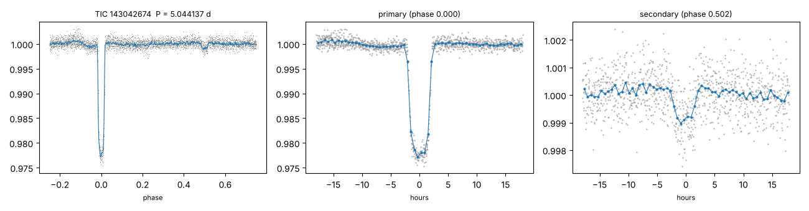
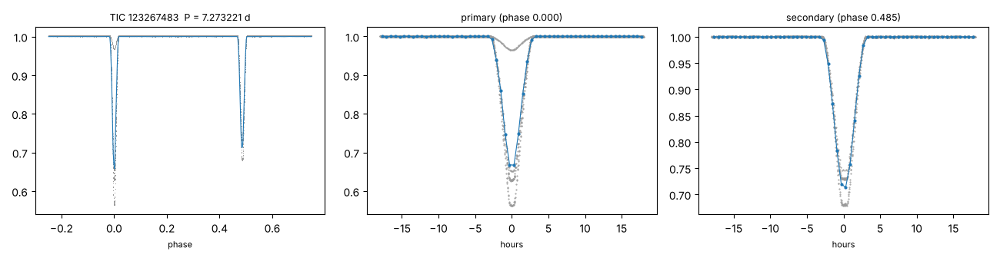
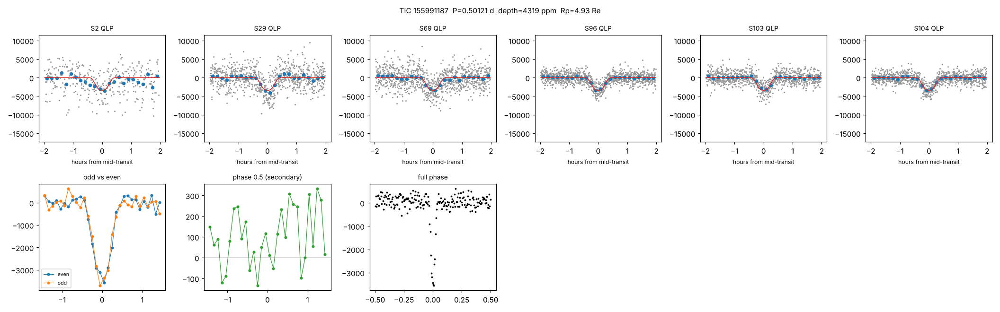

# Searching TESS for undiscovered planets and stars

An independent search of public NASA TESS data, run by Claude Code in October 2026, inspired by the
[TIC 4206066 Reddit post](../tic4206066/). The goal was to find a planet or star nobody had reported.

## Results

- **158,263 stars searched.** These were dwarf and subgiant stars in TESS Sectors 104 and 105, observed April to June 2026.
  For 40,000 stars seen in both sectors there is also a combined two-sector search
  ([status below](#combined-two-sector-search)).
- **The search found real signals.** 528 of its candidates matched planets, TOIs, pipeline alerts or eclipsing binaries
  that were already known.
- **No new planet could be validated.** About 160 planet-like signals were tested for recurrence in every other TESS
  sector from 2018 to 2026. Three survived as new, uncatalogued, repeating transit-like signals:
  TIC 155991187, TIC 72651793 and TIC 245976814. Each also has a more likely non-planet explanation; see below.
- **30 eclipsing or close binary stars, characterised for the first time.** Each is a star with a companion star whose
  orbital period and eclipses had never been published.
  - 28 were previously only flagged as "eclipse-like" in an unvetted neural-network list of about 873,000 TESS stars
    ([Kostov et al. 2025](https://ui.adsabs.harvard.edu/abs/2025ApJS..279...50K), table 2), which gives no period, depth or vetting.
  - 2 (TIC 114787953 and TIC 100666720) are not in that list or any other catalogue checked.
  - For 2 others, Gaia already has an orbital solution, so the binarity was known and only the eclipses are new.

  The accurate claim is therefore *first vetted confirmation and characterisation*, not first-ever detection.

## Highlights

**TYC 7034-792-1 (TIC 143042674): a Sun-like star with a small M-dwarf companion**

| | |
|---|---|
| Period | 5.044137 ± 0.000003 d |
| Primary eclipse | 2.2 % deep, flat-bottomed |
| Secondary eclipse | 870 ppm at phase 0.502 |
| Companion size | 0.138 star radii, about 0.20 solar radii (twice Jupiter's radius) |

- The secondary eclipse gives a TESS-band brightness temperature of about 2,900 K. That makes the companion a low-mass
  M dwarf of roughly 0.15–0.2 solar masses.
- Gaia DR3 independently measured the primary's radial velocity changing by about 35 km/s over 22 visits. That is
  what a stellar-mass companion on a 5-day orbit should produce; a planet would move the star by less than 0.5 km/s.

**TYC 7006-2246-1 (TIC 123267483): near-twin stars**

- 7.273221-day orbit, with 32–44 % and 28–32 % eclipses.
- Timed over 387 orbits from 2018 to 2026.

**TIC 100666720: a pair of M dwarfs 122 pc away**

- 7.341134-day orbit, with alternating 6.4 % and 5.0 % eclipses that are consistent in every sector.
- The search first found half this period. Each sector's odd and even eclipses have different depths, which shows the
  true orbit is twice as long.
- Not in any catalogue checked.

**Eccentric orbits**

- CD−31 1060 (TIC 122543151) and TYC 7000-227-1 (TIC 179677500) have secondary eclipses well away from half phase
  (0.452 and 0.568).
- TYC 8341-933-1 (TIC 217648205) is eccentric, with its secondary at phase 0.38, and shows visible pulsations.

## All 30 binaries

Periods come from eclipse timing across 2018–2026. Depths are averages over pipelines, which dilute differently.
For every system the pixel check places the eclipse on the target, within 2.5σ of its catalogue position.
For 22 of the 30, no Gaia star within 42″ is bright enough to cause the eclipse.
Full numbers are in [`candidates/new_eclipsing_binaries.csv`](candidates/new_eclipsing_binaries.csv) and folded light curves
in [`candidates/final_figs/`](candidates/final_figs/).

| TIC | Other name | T mag | Period (d) | Primary | Secondary (phase) | Sectors | Type | Notes |
|---|---|---|---|---|---|---|---|---|
| 146708570 | - | 11.49 | 4.732100 | 34.2 % | 22.60 % (0.500) | 5 | detached | Gaia RV amplitude 121 km/s; RUWE 15 |
| 123267483 | TYC 7006-2246-1 | 10.46 | 7.273221 | 31.8 % | 27.79 % (0.485) | 4 | detached | near-twin |
| 80064194 | TYC 8394-1748-1 | 10.55 | 5.810694 | 19.1 % | 7.26 % (0.500) | 4 | detached |  |
| 122543151 | CD-31 1060 | 9.95 | 7.483459 | 17.6 % | 10.61 % (0.452) | 4 | detached | eccentric; RUWE 4.4 (tertiary?) |
| 114917180 | - | 12.00 | 2.406130 | 13.9 % | 7.59 % (0.500) | 4 | detached |  |
| 142274982 | UCAC2 11682533 | 11.47 | 7.93719 | 12.7 % | 1.39 % (0.507) | 4 | detached |  |
| 197958602 | [R97] GRB 790406 2 | 11.93 | 5.417814 | 11.3 % | 8.60 % (0.500) | 8 | detached | Gaia RV amplitude 180 km/s |
| 179677500 | TYC 7000-227-1 | 10.82 | 7.911417 | 11.1 % | 3.31 % (0.568) | 5 | detached | eccentric |
| 156003824 | TYC 8027-291-1 | 11.64 | 4.969439 | 7.5 % | 0.63 % (0.502) | 6 | detached | cool companion (secondary 8 % of primary) |
| 143345010 | TYC 7940-1151-1 | 10.63 | 2.669561 | 7.0 % | 1.47 % (0.500) | 4 | detached | Gaia NSS solution exists (binarity known; eclipses new) |
| 180444443 | TYC 7001-246-1 | 11.19 | 2.497060 | 6.9 % | 1.05 % (0.502) | 6 | detached |  |
| 89040715 | TYC 8003-1087-1 | 11.02 | 4.621055 | 5.9 % | 3.31 % (0.502) | 4 | detached | RUWE 8.2 (tertiary?) |
| 100666720 | - | 13.39 | 7.341134 | 5.8 % | 0.14 % (0.117) | 4 | detached | M-dwarf pair, 122 pc; alternating 6.4 % / 5.0 % eclipses, so the orbit is twice the search period |
| 48939280 | - | 13.25 | 2.73651 | 5.5 % | 3.72 % (0.500) | 4 | detached | M-dwarf pair |
| 128677131 | - | 11.53 | 1.251952 | 5.4 % | 2.78 % (0.500) | 5 | detached |  |
| 217648205 | TYC 8341-933-1 | 10.54 | 7.61104 | 4.5 % | 0.31 % (0.382) | 6 | detached | eccentric (secondary at phase 0.38); pulsations visible; G=13.7 star 3.8" away cannot be separated by TESS |
| 396957421 | TYC 8352-1599-1 | 10.94 | 6.329213 | 4.2 % | 1.20 % (0.500) | 6 | detached | neighbours at 7" (T~14.3) and 15" (T~12.1) could contribute; centroid within 2.0 sigma |
| 129032726 | TYC 7955-2777-1 | 11.97 | 3.350564 | 4.0 % | 1.78 % (0.492) | 3 | detached | RUWE 19.5 |
| 320327029 | TYC 8786-1621-1 | 10.55 | 4.440732 | 3.9 % | 0.70 % (0.500) | 6 | detached |  |
| 49617965 | TYC 7016-804-1 | 11.35 | 3.76520 | 3.7 % | 0.22 % (0.500) | 3 | detached | cool companion (secondary 6 % of primary); BLS first found 4x the period |
| 200247352 | - | 11.03 | 3.338011 | 3.7 % | 1.31 % (0.500) | 5 | detached |  |
| 197985960 | - | 11.74 | 3.329832 | 3.0 % | 2.45 % (0.500) | 7 | detached |  |
| 278802197 | TYC 7999-451-1 | 11.79 | 1.061827 | 2.8 % | 1.35 % (0.502) | 4 | detached | Gaia NSS solution exists (binarity known; eclipses new) |
| 143042674 | TYC 7034-792-1 | 10.69 | 5.044137 | 2.2 % | 0.09 % (0.502) | 2 | detached | G + M-dwarf companion (EBLM-like); Gaia RV amplitude 35 km/s |
| 261500541 | CD-66 2541 | 9.77 | 3.126963 | 1.6 % | 0.09 % (0.502) | 11 | detached | grazing; cool companion (secondary 5 % of primary) |
| 231286114 | TYC 8054-890-1 | 10.55 | 2.020458 | 1.3 % | 0.77 % (0.500) | 4 | detached |  |
| 115242114 | TYC 7527-529-1 | 11.52 | 3.935908 | 1.1 % | 0.17 % (0.500) | 5 | detached | RUWE 46, plx 0.16 mas (astrometry unreliable) |
| 32398505 | TYC 7003-400-1 | 11.50 | 0.601493 | 2.0 % | 0.34 % (0.505) | 4 | contact/ellipsoidal |  |
| 114787953 | TYC 7951-1401-1 | 11.74 | 0.60577 | 1.0 % | 0.67 % (0.500) | 3 | contact/ellipsoidal | not in Kostov+25 table 2 |
| 71315603 | CD-44 14744 | 11.02 | 0.507699 | 0.6 % | 0.30 % (0.500) | 3 | contact/ellipsoidal |  |

## Planet-like signals

None of these is a validated planet. Each is a real, repeating signal that is not in the TOI, CTOI or SPOC alert
lists, or any variable-star catalogue.

**TIC 155991187**

- **System:** a K dwarf about 150 pc away, in a triple-star system. It has a co-moving M-dwarf companion 8.2″ away, and
  Gaia's RUWE of 21 means it also has an unresolved close companion.
- **Signal:** a 12-hour period (0.5012110 d) with dips about 2.9 ppt deep, the same in 6 sectors from 2018 to 2026.
  Alternate dips match, there is no secondary eclipse, and there is no ellipsoidal variation (< 80 ppm).
- **Which star:** a directional pixel test disfavours the 8.2″ companion as the source (Δχ² ≈ 11).
- **TRICERATOPS:** false-positive probability 0.93. The most likely explanation is an eclipsing binary hidden inside
  the system.

**TIC 72651793**

- **Signal:** P = 0.6345 d and 410 ppm, found independently in 3 sectors.
- **Against a planet:** alternate dips differ by 3.5σ, and the transit implies a star much denser than the target.
- **TRICERATOPS:** false-positive probability 0.86.

**TIC 245976814**

- **Signal:** P = 0.5070757 d, 1.1–1.5 ppt, consistent in 4 sectors from 2021 to 2026, on an F/G star (T = 11.6).
  Alternate dips match and there is no secondary eclipse.
- **Location:** on target in Sector 104, but 20″ off target (2.8σ) in Sector 66.
- **Blend risk:** faint Gaia stars 5–6″ away could mimic the dip if they are eclipsing binaries.
- **TRICERATOPS:** false-positive probability 0.19, with a planet on the target the most likely scenario (54 %).
  That formally counts as a "likely planet" by TRICERATOPS's own criteria.
- **But a directional pixel test points elsewhere.** In Sectors 39 and 66 the dip falls about 21″ south-east of the
  target, on a G = 15.3 star 16.6″ away that would need only a ~2 % eclipse to produce the whole signal.
  Sector 104 prefers the target, but overall the neighbour fits better (χ² 12.6 vs 19.6 for 6 degrees of freedom).
- **Verdict:** most likely an eclipsing binary on that neighbour. Ground photometry separating the 16.6″ star would settle it.

Most other planet-like signals were ruled out. They were blends located 15–45″ off target, eclipsing binaries
(secondary eclipses, unequal alternate dips), δ Scuti pulsation troughs, rotational variables, distant giants, or
dips too long or too short for the star. See [`FINDINGS.md`](FINDINGS.md).

## Combined two-sector search

MULTI_PLACEHOLDER

## How it was done

| Step | What | Code |
|---|---|---|
| Targets | QLP target lists for S104/S105 with TIC v8.2 parameters. Kept T ≤ 12 stars with R ≤ 2.5 R☉, plus cool dwarfs to T ≤ 13.5 | `tic_mast_all.py`, `make_sample.py` |
| Light curves | MIT QLP `DET_FLUX`, quality-flagged points removed, binned to 10 min. Per-camera time windows hit by sector-wide systematics are found from thousands of stars and masked | `fetch_qlp.py`, `common_mode.py` |
| Search | Box least squares from 0.5 d to half the baseline. Isolated single events masked, best of the top 10 peaks by red-noise S/N, checks at 2× and 3× the period | `bls.py`, `run_search.py` |
| Validation | Recovers known TOIs. Injection tests recover 96–99 % of signals with expected S/N > 25 on quiet stars | `val_known.py`, `inject.py` |
| Selection | Red-noise S/N ≥ 9, ≥ 3 transits, no dominant single event. Sorted into planet, eclipsing-binary and variable tracks using odd/even depths, secondary eclipse and phase-curve flatness | `select_cands.py`, `classify.py` |
| Novelty | TOI, CTOI, NASA Exoplanet Archive, 341,351 SPOC TCEs, VSX, ASAS-SN (variables and EBs), Gaia DR3 EB and variability classes, Prša+22, Kostov+25, IJspeert+24, ATLAS, SuperWASP, Gao+25, WISE, SIMBAD, and every VizieR table within 15″ | `known.py`, `catalog_check.py`, `eb_triage.py` |
| Recurrence | Every other TESS sector of the star (SPOC 2-min, TESS-SPOC or QLP), searched near the period and compared with the same search at random periods | `stage2.py` |
| Vetting | Transit-model fit and stellar density, held-out sectors, TESScut difference imaging (including a directional test), Gaia neighbours, TRICERATOPS, ellipsoidal limits, Gaia RV/RUWE/NSS | `vet.py`, `vet_report.py`, `centroid.py`, `offset_test.py`, `run_tri.py` |
| Binaries | Eclipse timing, primary and secondary depths, secondary phase, quality cuts, visual review of every fold | `eb_analysis.py`, `eb_select.py`, `eb_final.py`, `final_plots.py` |
| Independent review | Adversarial reviews by GPT-5.5 (two rounds) and Gemini 3.1 Pro via OpenRouter, $0.86 total. They prompted the Kostov+25 catalogue check, the directional centroid test, better wording, and fixes to two periods and the figure set | `review.py`, [`reviews/`](reviews/) |

## Caveats

- **Novelty is limited to what is searchable online:** VizieR, SIMBAD, MAST, ExoFOP and the NASA Exoplanet Archive.
  A binary could still appear in a paper, survey database or observer report that none of these index.
- **TESS pixels are 21″ wide,** so the pixel test cannot separate stars a few arcseconds apart, and unresolved
  companions can never be excluded with TESS data alone.
- **No spectroscopy or high-resolution imaging was available.** Companion masses and temperatures are estimates from
  eclipse depths and catalogue values.

## Possible next steps

1. Submit the binaries to the [AAVSO Variable Star Index](https://www.aavso.org/vsx/), the standard home for newly
   characterised variable stars.
2. Get radial velocities for TYC 7034-792-1, to measure the M dwarf's mass directly, and for TIC 155991187.
3. Get high-resolution imaging or seeing-limited ground photometry of TIC 155991187 and TIC 245976814 during predicted
   transits, to find which star the dips come from.

## Files

| Path | What it is |
|---|---|
| `src/` | Pipeline code |
| `FINDINGS.md` | Working log: every candidate examined and why it was kept or rejected |
| `candidates/new_eclipsing_binaries.csv` | Final binary table: coordinates, Gaia data, ephemerides, depths, localisation, neighbours |
| `candidates/final_figs/` | Folded light curves for all 30 binaries, plus contact sheets |
| `candidates/TIC*/`, `candidates/EB_TIC*/` | Vetting plots and numbers for individual candidates |
| `reviews/` | Dossiers sent for independent review, and the reviews |
