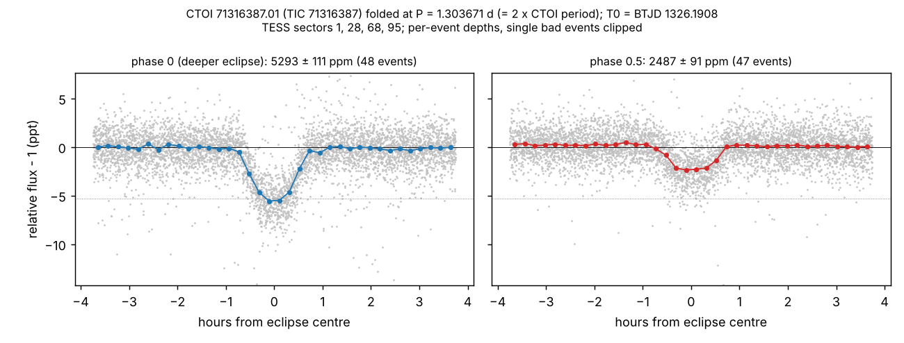

# Existing ExoFOP planet candidates that look like eclipsing binaries

*Status: complete (2026-10-13). Nothing has been submitted anywhere. The draft notes below are for a human
to review before anything is posted.*

## Summary

Our search of TESS Sectors 104–105 recovered the signals of 94 existing community planet candidates (CTOIs) on 71
stars. For 18 of these candidates, or of nearby TOIs, the classifier flagged unequal alternate dips or a secondary
eclipse; 21 obvious eclipsing binaries from one 2019 bulk upload were excluded. Each of the 18 was vetted by an
investigator, who ran the same tests on 5–7 known planets as controls, and was then re-analysed with separate code
by an adversarial referee.

**Ten of the 18 survived as eclipsing binaries or nearby-binary blends, and ExoFOP records this for none of them.**
A third check, run separately on light curves fetched fresh from MAST, confirms nine of them strongly. The tenth,
CTOI 327712163.01, stays only suggestive (2.7–4σ).
All ten are still listed as planet candidates with no TFOP disposition. Seven come from published discovery papers:
DTARPS (Melton et al. 2023), RAVEN (Lafarga et al. 2026), DIAmante (Montalto et al. 2020), Bryant & Van Eylen (2025)
and Feinstein et al. (2019). Two of the RAVEN ones were uploaded in August 2026 as "high-probability planets".

The other eight were false alarms or are already documented: three real planets, whose flags came from corrupted
light curves, and five binaries or blends already noted on ExoFOP or in the literature.

This is the one result of the project that fits an existing ExoFOP channel. An **observing note** on an existing
target needs no published paper, but it does need an approved ExoFOP account. The alternative is to tell the
candidates' authors, who can update their own entries.

## The ten

"Alternating depths" means that at the catalogued period, every other dip is deeper. The true orbit is then twice
the catalogued period, with two different eclipses. Planets do not do this. Significances are the referee's own,
calibrated against random fake epochs. The same odd/even tests on about 20 known planets used as controls gave
at most 1.5σ.

| CTOI (source) | What the data show | Key numbers | Already known elsewhere? |
|---|---|---|---|
| **102064145.01** (DTARPS 120) | Blend: light from a catalogued eclipsing binary 23″ away (Gaia DR3 4982105786405613952, G = 16.5) | P matches Gaia's to 0.5σ; Gaia's eclipse time lands 6 min from TESS's after 655 orbits; secondary at phase 0.500 (10–16σ); difference images in 7 sectors put the source on the binary | The neighbour is in Gaia DR3 and VSX as an eclipsing binary; nobody had linked it to the CTOI |
| **218856662.01** (Bryant & Van Eylen 2025) | Blend: light from a catalogued eclipsing binary 10.6″ away (TIC 218856692 = Gaia DR3 5952123561802121472, G = 17.9) | P = 1.1295000 d vs Gaia 1.129524 d (0.6σ); Gaia epoch lands on the TESS dips (20 ± 21 min); difference images (S93, S104) point to it; target position disfavoured (Δχ² 58–124) | Neighbour catalogued (Gaia, VSX); link not made |
| **100918213.01** (DIAmante) | Blend at twice the CTOI period: a catalogued eclipsing binary 14″ away (Gaia DR3 4964530230474371968, G = 15.7) | True P = 0.5128982 d; alternating 5.8 / 3.2 ppt eclipses (z ≈ 35); difference images in 4 sectors move 10–15″ to the neighbour; Gaia eclipse time matches to 0.002 in phase | Prša+22 lists the CTOI star as an eclipsing binary at 0.51293 d, without identifying the neighbour as the source |
| **71316387.01** (RAVEN, 2026) | Eclipsing binary at twice the CTOI period | True P = 1.303671 d; alternate dips ~5,700 vs ~2,700 ppm (> 15σ; same parity in all 5 sectors 2018–2026); nothing at phase 0.5 | No. RAVEN's own plots show the alternation, but the paper does not flag it |
| **147285336.01** (RAVEN, 2026) | Eclipsing binary at twice the CTOI period | True P = 3.36999 d; ~5,400 vs ~2,400 ppm (> 10σ, every sector); shallow eclipse ~21 min off half-phase; ±17 min timing residuals; RAVEN ephemeris ~2 h stale | No |
| **234503282.01** (Feinstein et al. 2019) | Eclipsing binary at twice the CTOI period | True P = 2.876461 d; 17.3k vs 14.4k ppm (> 20σ; same parity in all 10 sectors); equal durations; nothing at phase 0.5. The ExoFOP epoch is 1 day off (typo) | VSX lists the star as EA from KELT at 1.438 d, but nothing shows it is a binary rather than a planet, and ExoFOP has no note |
| **206599822.01** (DTARPS 219) | Eclipsing binary at twice the CTOI period | True P = 2.151597 d; 16.3 vs 14.3 ppt (paired test 18σ, all 9 sectors); spot modulation at the orbital period. The CTOI epoch is 0.31 in phase off | No |
| **65450588.01** (DIAmante) | Eclipsing binary at twice the CTOI period | True P = 1.2973383 d; ~10.3 vs ~7.2 ppt (z ≈ 20); second eclipse at phase 0.500; V-shaped; source within 2.5″ of the target | DIAmante flagged the star as a likely Gaia binary, and Gaia DR3 has a 123-d orbit, but no eclipsing-binary identification |
| **382360740.01** (unpublished, 2021) | Eclipsing binary on the target: an F star with an M-dwarf companion | V-shaped ~8 % primary, P = 5.131133 d; 0.6 % secondary at phase 0.500 in all 6 sectors (z > 10); the Gaia DR3 orbit of this star has the same period, and its conjunction matches. The CTOI's period (5.15 d) and depth (257 ppm) are wrong | Gaia DR3 orbit and SIMBAD "SB*"; ExoMiner++ labels the SPOC signal a false positive; nothing on ExoFOP |
| **327712163.01** (DTARPS 368) | Probably an eclipsing binary at twice the CTOI period, host not determined (**weakest of the ten**) | True P = 0.7807704 d; alternate dips differ by 5.1 ± 1.3 % (SPOC, ~4σ), 2.7 ± 1.1 % (independent QLP, ~2.5σ), same sign in 15 of 16 orbits; no occultation where a hot Jupiter would show > 500 ppm; it would sit inside its Roche limit unless denser than 1.8 g/cm³ | Only an automated machine-learning "EA" label (Gao+25) |

For five of the binaries close to the target (327712163, 71316387, 147285336, 234503282 and 206599822), Gaia's
radial velocities argue against the bright star itself being the eclipsing pair. The eclipses then most likely come
from an unresolved companion or a background star, so the notes say "host not determined". 65450588 is similar: the
eclipsing star is either bound to the target or unresolved from it. The exception is 382360740.01, whose Gaia orbit
puts the companion on the target itself.

## Third check: our own folds

Light curves were fetched fresh from MAST: SPOC 2-min, then TESS-SPOC, then QLP, best available per sector. They were
detrended with the eclipses masked and folded at the proposed period. Each eclipse's depth was measured event by
event, with single corrupted events clipped. The difference is phase 0 minus phase 0.5, with a label-permutation
null. Code: [`recheck_and_figures.py`](recheck_and_figures.py); numbers: [`recheck.json`](recheck.json).

| CTOI | Folded at | Phase 0 depth (ppm) | Phase 0.5 depth (ppm) | Difference | Sectors with phase 0 deeper | Figure |
|---|---|---|---|---|---|---|
| 327712163.01 | 0.7807704 d | 8623 ± 75 | 8334 ± 75 | 2.7σ (permutation 2.7σ) | 8 of 8 | [fig](CTOI_327712163.01.png) |
| 206599822.01 | 2.151597 d | 14350 ± 160 | 12125 ± 163 | 9.7σ (permutation 7.6σ) | 7 of 7 | [fig](CTOI_206599822.01.png) |
| 71316387.01 | 1.303671 d | 5293 ± 111 | 2487 ± 91 | 19.6σ (permutation 8.6σ) | 3 of 3 | [fig](CTOI_71316387.01.png) |
| 147285336.01 | 3.36999 d | 4639 ± 133 | 2233 ± 119 | 13.5σ (permutation 5.6σ) | 4 of 4 | [fig](CTOI_147285336.01.png) |
| 234503282.01 | 2.876461 d | 14091 ± 127 | 11895 ± 66 | 15.4σ (permutation 9.5σ) | 10 of 10 | [fig](CTOI_234503282.01.png) |
| 65450588.01 | 1.2973383 d | 7498 ± 167 | 5551 ± 137 | 9.0σ (permutation 6.8σ) | 2 of 2 | [fig](CTOI_65450588.01.png) |
| 382360740.01 | 5.131133 d | 67831 ± 1278 | 6414 ± 203 | 47.4σ (permutation 7.2σ) | 6 of 6 | [fig](CTOI_382360740.01.png) |
| 102064145.01 | 4.392547 d | 3384 ± 141 | 1167 ± 82 | 13.6σ (permutation 6.8σ) | 7 of 7 | [fig](CTOI_102064145.01.png) |
| 218856662.01 | 1.1295 d | 1755 ± 104 | 301 ± 124 | 9.0σ (permutation 7.4σ) | 4 of 4 | [fig](CTOI_218856662.01.png) |
| 100918213.01 | 0.5128982 d | 5312 ± 51 | 3253 ± 56 | 27.1σ (permutation 16.6σ) | 4 of 4 | [fig](CTOI_100918213.01.png) |

For the three blends (102064145, 218856662, 100918213), the phase-0.5 depth is the neighbour's diluted secondary
eclipse. For 218856662 it is small (about 300 ppm), as expected from that binary's Gaia eclipse depths. For
382360740 the 6,400 ppm phase-0.5 dip is the M dwarf's own secondary eclipse. Figures for the four
alternating-depth cases with the clearest signals: [71316387](CTOI_71316387.01.png),
[147285336](CTOI_147285336.01.png), [234503282](CTOI_234503282.01.png), [206599822](CTOI_206599822.01.png).

*CTOI 71316387.01, a RAVEN "high-probability planet", folded at twice its catalogued period. Alternate dips are
5,300 and 2,500 ppm deep. A planet would make every dip the same.*

## The other eight

| Candidate | Result |
|---|---|
| CTOI 88571421.01, 115693377.01 (DTARPS) | Known low-mass eclipsing binaries (EBLM J0315-24, EBLM J0027-41); already noted on ExoFOP |
| CTOI 92352621.01 (DTARPS) | The known planet WASP-94 A b leaking into WASP-94 B's aperture; already noted on ExoFOP |
| CTOI 278536652.01 (DIAmante) | Stellar companion (Gaia orbit at the same period); already noted on ExoFOP |
| CTOI 321044007.01 | Eclipsing binary; the submitter has already added an FP note, and it is in VSX |
| TOI 3288.01 | A confirmed hot Jupiter (Frensch et al. 2026); our flag was a false alarm |
| TOI 6787.01, TOI 2486.01 | Planet candidates. The flags came from corrupted QLP light curves (scattered light and bad background subtraction) |

## Draft observing notes (for human review; not posted)

ExoFOP notes are short. These drafts were written by the referees and checked against the numbers above.

- **102064145.01:** NEB: the signal comes from Gaia DR3 4982105786405613952 (G = 16.5, 23″ ESE), a Gaia DR3/VSX
  eclipsing binary (P = 4.39254 d). TESS gives P = 4.392547 ± 0.000004 d (0.5σ from Gaia). Gaia's primary epoch lands
  6 min from the TESS T0 after 655 cycles (σ 23 min). Secondary at phase 0.500, 1.35 ppt. Difference images in
  7 sectors put the source 0.02–0.26 px from the binary and 1.1–1.3 px from the target.
- **218856662.01:** Signal matches catalogued EB TIC 218856692 = Gaia DR3 5952123561802121472 (10.6″ S;
  P = 1.12952 d). TESS QLP S12/39/93/104 give P = 1.1295000(23) d. The Gaia epoch falls on the TESS dips. Difference
  images (S93, S104) put the source ~8–9″ S, toward the binary; the target position is disfavoured. Likely NEB.
- **100918213.01:** True period is twice the CTOI value: P = 0.5128982 d, with alternate eclipses ~5.8 and ~3.2 ppt.
  Difference images in S30/S97/S104/S105 move the source to within ~4″ of Gaia DR3 4964530230474371968 (14″,
  G = 15.7), a Gaia DR3/VSX eclipsing binary with P = 0.512897 d whose epoch matches. Suggest NEB/FP.
- **71316387.01:** *Superseded by the dedicated campaign in [`TIC71316387_campaign/`](TIC71316387_campaign/). The
  final observing note and supporting report, ready to post, are in
  [`TIC71316387_campaign/exofop_submission/`](TIC71316387_campaign/exofop_submission/). The campaign's main corrections: the source is within 1.24″, not 4″; the
  eclipsing stars are red M dwarfs; a bound triple is favoured.* Original draft: alternate events differ in depth by
  ~2× in every sector (TESS S1, 28, 68, 95, 105). PDCSAP gives ~5,700 vs ~2,700 ppm, > 15σ; the same tests on 6 known
  planets give < 1.1σ. Indicates an EB at P = 1.303671 d, deeper eclipse BJD_TDB 2460165.670. Gaia RVs are constant,
  so the EB is likely an unresolved or background star.
- **147285336.01:** Alternate events differ in depth in every sector (~5,400 vs ~2,400 ppm, > 10σ), and the
  shallow events fall ~21 min off half-phase: EB at P = 3.36999 d, deep T0 BJD_TDB 2460167.944. The RAVEN ephemeris
  predicts 2026 events ~2 h early. The star is a Gaia SB1 (287 d), so the EB is probably an unresolved companion.
- **234503282.01:** EB at P = 2.876461 d (twice the CTOI period). Alternate events are 17.3k vs 14.4k ppm in all
  10 sectors (> 20σ), with equal durations and nothing at phase 0.5. Deeper T0 BJD_TDB 2460181.4022. Gaia RVs are
  constant, so the EB is likely the 0.53″ SOAR companion or another unresolved star. The ExoFOP CTOI T0 is 1 day off.
- **206599822.01:** EB at P = 2.151597 d (twice the CTOI period). Alternate depths are 16.3 vs 14.3 ppt, with the
  same sign in all 9 sectors. Deeper eclipse BJD 2460204.4410. Coherent 3–4.5 ppt modulation at 2.15 d. The CTOI
  epoch is 0.31 in phase off. On target or an unresolved companion; the 4.8″ neighbour would need > 100 % eclipses.
- **65450588.01:** True period is twice the CTOI value: P = 1.2973383 d. Eclipses ~10.3 and ~7.2 ppt, with the
  second at phase 0.500 ± 1.5 min; V-shaped. Five control planets show nothing similar. The source is within ~2.5″,
  and the 29″ M dwarf is disfavoured. Unresolved or bound EB (compare the Gaia DR3 123-d SB1 orbit).
- **382360740.01:** Likely EB on target, not a planet. V-shaped ~8 % primary, P = 5.131133(3) d,
  T0 BTJD 1633.032. A ~0.6 % secondary at phase 0.500 in all 6 sectors. The Gaia DR3 SB1 orbit of this star
  (P = 5.1304 d, f(M) = 0.031 M☉) predicts a conjunction matching the primary. The CTOI's P = 5.15 d and its 257 ppm
  depth are incorrect.
- **327712163.01:** Not a planet on this F star. No occultation at phase 0.5 (3σ < 130 ppm, where a hot Jupiter
  needs ≥ 500 ppm). Alternating depths of 5.1 ± 1.3 % in SPOC and 2.7 ± 1.1 % in QLP: likely an EB at
  P = 0.7807704 d. Source within ~4″, but Gaia's RVs are constant, so the host is not determined.

## Caveats

- **The analysis was AI-run.** Every claim above was reproduced by a second, independent analysis, but no human has
  reviewed the light curves yet. Anyone posting a note should look at the figures first.
- **TESS cannot resolve companions closer than about one pixel (21″).** For the binaries without a catalogued
  neighbour, the eclipsing star is unidentified.
- **"Not on ExoFOP" was checked on 2026-10-13.** Authors may have private follow-up; re-check before posting.

## Files

- [`vetting_results.json`](vetting_results.json): investigators' and referees' full structured reports.
- `CTOI_*.png`, [`recheck.json`](recheck.json) and [`recheck_and_figures.py`](recheck_and_figures.py): the third
  check and its figures.
