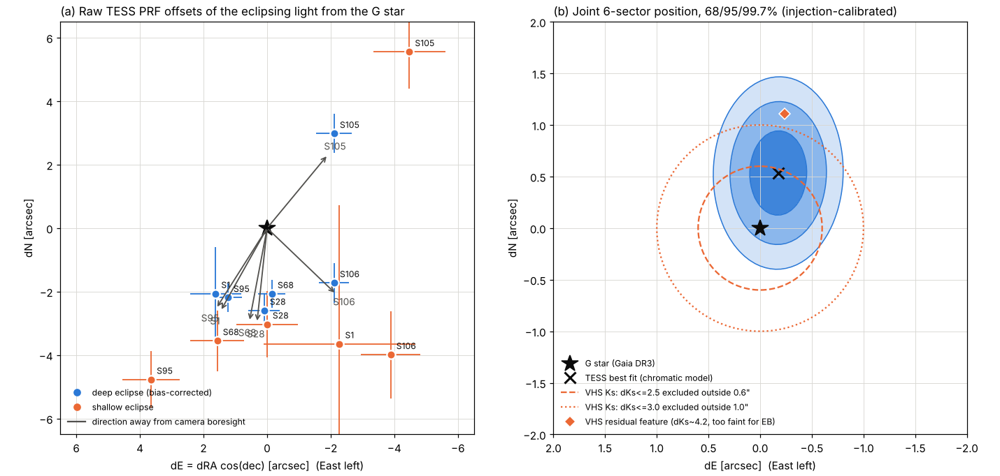
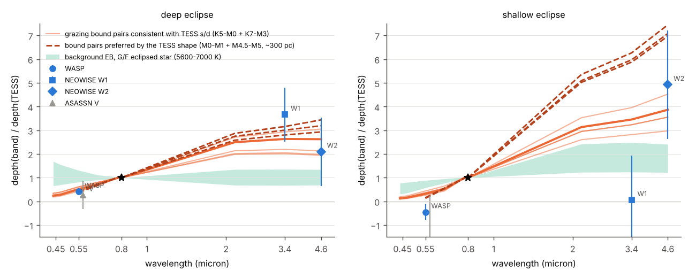

# TIC 71316387: a likely triple system hiding behind a "planet candidate"

*Status, 2026-10-15: analysis complete. Four investigations were run, each checked by an adversarial referee, then
combined in a synthesis that a final referee checked again. The wording below is the final referee's corrected
version. Nothing has been submitted anywhere. AI-run analysis; no human has reviewed it yet.*

## In one paragraph

The TESS signal on TIC 71316387 (TYC 8001-154-1, a Sun-like G star 297 pc away), listed on ExoFOP as the RAVEN
"high-probability planet" CTOI 71316387.01, is an **eclipsing binary at P = 1.3036723 d**, twice the listed
period. Its two eclipses are unequal (5,770 and 2,600 ppm).

The eclipses come from a **red, early-M star within 1.24″ of the G star** (95%), not from the G star itself. They
could possibly come from a late-K star. Under main-sequence assumptions the eclipsing pair is an **~M1–M2.5 + ~M4–M4.5
dwarf pair**. It supplies ~2.6% of the TESS light. Chance-alignment statistics favour a **physically bound
hierarchical triple** (the G star plus this M-dwarf pair) over an unrelated background pair, by odds of order
10³–10⁴. The association, the separation (most likely ≲ 0.9″, i.e. ≲ 270 au) and the masses still need direct
confirmation by high-resolution imaging, a second imaging epoch or radial velocities of the M dwarfs.

## What was established, and how sure it is

| Finding | How it was shown | Confidence |
|---|---|---|
| Not a planet: an eclipsing binary at 2× the CTOI period | Alternate eclipses differ by ~2× in all six TESS sectors (2018–2026). Independent checks reached > 15σ. The deeper eclipse falls on the same parity in every sector | Very strong |
| The G star is not one of the eclipsing stars | Gaia DR3 measured its radial velocity 15 times over 946 days and found it constant. Even a 0.1 M☉ eclipsing partner would make it swing by ≥ 18 km/s | Very strong |
| The source is within 1.24″ of the G star (95%; 1.48″ at 99.7%) | TESS difference images in six sectors. The raw 2–3.6″ offsets turned out to be a colour effect of the TESS optics (redder light shifted outward), calibrated with ~2,500–5,500 field stars. Corrected for it, all sectors agree; ≥ 1.5″ is excluded at p = 0.002 | Strong (reproduced by both referees) |
| The eclipsed star is red (early-M, possibly late-K) | **(a)** Size of the TESS colour shift: BP−RP ≈ 2.3. **(b)** Eclipse depth in visible light (SuperWASP, 2006–07) is 0.36–0.42 of the TESS depth. **(c)** Infrared (NEOWISE W1) depth is 3.7 ± 1.1× the TESS depth. G/F and early-K eclipsed stars are excluded | Strong |
| The pair supplies ≥ 2.2% of the TESS light (~2.6% if main-sequence) | Physical eclipse model with MCMC, injection-recovery tests, and a referee's independent model. The shape alone gives only a lower limit | Moderate (prior-dependent) |
| Components ~M1–M2.5 (0.45 ± 0.04 M☉) + ~M4–M4.5 (0.20 ± 0.02 M☉) | The eclipse model under main-sequence relations, plus the colours. The masses are **not dynamical** and need ~10–15% departures from standard main-sequence values, which is common for active short-period M-dwarf binaries | Moderate |
| The pair's photometric distance (~210–330 pc) is consistent with 297 pc | Main-sequence luminosity of the fitted pair | A consistency check, not evidence of binding: most chance-aligned M dwarfs of this colour would also fit |
| Orbit circular and synchronised; stable for 20 years | e·cosω = 0.0006 ± 0.0005. Spot modulation at exactly the orbital period. Linear ephemeris over 2018–2026, and the eclipse is recovered at the predicted time in 2006–07 SuperWASP data | Strong |
| An unresolved companion is seen by Gaia | Gaia DR3 image diagnostics: double-peaked images in 41% of scans, and BP/RP blending flagged in 47/47 transits. 0 of 2,650 speckle-confirmed single stars match all four diagnostics | Moderate |
| **Bound triple favoured over chance alignment** | Prior odds from Gaia star counts and multiplicity statistics, times position and light-fraction likelihoods. Recomputed independently by the final referee | Odds of order 10⁴ (5×10³–1.4×10⁴ in baseline variants; 6×10²–4×10⁴ across 160 tested choices; ~200 in the worst case). **Probabilistic, not a demonstration** |

*Left: raw TESS offsets in six sectors all point away from each camera's boresight, the signature of the colour
effect rather than a real offset. Right: colour-corrected position, with 68/95/99.7% regions and the VHS
infrared imaging limits.*

*Eclipse depth relative to TESS against wavelength. The deep eclipse is shallower in visible light (SuperWASP)
and deeper in the infrared (W1), as expected for M dwarfs. A G/F-coloured eclipsing star (green band) does not
fit.*

Further figures: [eclipse model fold](figures/eclipse_model_fold.png) (the secondary eclipse is flat-bottomed, a
total occultation), [eclipse timing](figures/eclipse_timing.png), and [Gaia image-diagnostic
calibration](figures/gaia_ipd_calibration.png).

## Adopted system parameters

Masses, radii, inclination and light fraction rest on main-sequence assumptions; see the caveats.

| Parameter | Value |
|---|---|
| G star | TIC 71316387 = TYC 8001-154-1 = Gaia DR3 6571343840265900544; 297.4 ± 1.5 pc; Teff ≈ 5,880 K, 1.07 R☉, 1.03 M☉, ~5 Gyr; RV −6.07 ± 0.86 km/s, constant |
| EB period, epoch | P = 1.30367228 ± 0.00000019 d; primary T0 = BJD_TDB 2460165.670416 ± 0.00018 |
| Diluted depths (TESS) | 5,770 ± 100 ppm (primary), 2,600 ± 55 ppm (secondary); ±8% between data products |
| Pair's share of TESS light | 2.6 ± 0.4% (hard lower limit 2.2%) |
| Undiluted depths | ~22% (primary), ~10% (secondary, total occultation under the main-sequence solution) |
| Primary | ~0.45 ± 0.04 M☉, 0.48 ± 0.02 R☉, ~3,550 K, ~M2V (M1–M2.5) |
| Secondary | ~0.20 ± 0.02 M☉, 0.21 ± 0.01 R☉, ~3,160 K, ~M4–M4.5V |
| Orbit | a = 4.35 R☉ (0.020 au); i ≈ 89°; circular; rotation synchronised |
| Separation from the G star | ≤ 1.24″ (95%, TESS); most likely ≲ 0.9″ (≲ 270 au projected). If the Gaia signature is the pair: ~0.15–0.85″ (median ~0.4″). If not: ~0.03–0.5″ |
| Position angle | Not constrained (weak, insignificant north-northwest hint) |
| Outer orbit (if bound) | a ~30–650 au, P ~10²–10⁴ yr; dynamically very stable |

## Predictions that follow-up can test

- **High-resolution imaging (decisive).**
  - Contrast relative to the G star: ΔKs ≈ 2.4–2.8, ΔH ≈ 2.6–2.9, Δ(832 nm) ≈ 3.7–4.0, ΔI ≈ 3.7–4.1, Δ(562 nm) ≈ 5.1–5.6.
  - Expected within ~0.9″, possibly inside 0.1″.
  - Near-infrared AO on an 8 m telescope is the best test; it should reach inside 0.1″ at this contrast.
  - A second epoch 1–2 years later tests common proper motion. Bound: relative motion < 2.5–4.3 mas/yr. Unrelated
    field M dwarfs: none of 77 matched stars move that slowly.
- **Spectroscopy (red or near-infrared).**
  - The M2 star's lines should swing by K₁ ≈ 52 km/s and the M4 star's by K₂ ≈ 117 km/s every 1.30 days.
  - Rotation v sin i ≈ 19 and 8 km/s.
  - If the pair is bound, its systemic velocity should be within a few km/s of the G star's −6.1 km/s.
- **Multi-colour eclipse photometry.**
  - Deep-eclipse depth ≈ 1,150 ppm in g′, 1,900 ppm in V, 5,600–6,700 ppm in i′ and ≈ 18,000 ppm in Ks.
  - The secondary eclipse should be flat-bottomed for ~36 min.
  - This tests the M-dwarf nature, not whether the pair is bound.
- **Gaia DR4 (planned December 2026).** Its epoch photometry should contain the eclipses (~3.6 and ~1.2 mmag in G).

## ExoFOP observing note and supporting report

The final observing note and an 8-page supporting PDF report, ready for the account holder to review and post, are in
[`exofop_submission/`](exofop_submission/), with posting instructions and a review log. Nothing has been posted. The
note supersedes the final referee's 470-character draft. It follows ExoFOP house style, learned from all 33,156 public
notes, and was fact-checked again. The review of the report also corrected a few numbers quoted on this page:

- the G star's Gaia FLAME radius is 1.08 R☉ (1.07 is the TIC value);
- the predicted V-band deep-eclipse depth is a range, 1,600–1,900 ppm;
- the W1/TESS ratio expected for an eclipsed G/F star reaches 1.35 in the most favourable case.

## Open issues and caveats

- **No direct evidence of association.** The bound case rests on chance-alignment odds and consistency checks.
- **Prior-driven numbers.**
  - The light fraction, masses, radius ratio, inclination and photometric distance all depend on the main-sequence
    assumption.
  - The light curve alone allows a larger light fraction (~7%) if e·sinω ≈ 0.03. That solution needs
    non-main-sequence stars and conflicts with the ellipsoidal limit and the colour.
  - Without the main-sequence term the odds fall to ~10³.
- **Temperature tension.** The archival colours give the eclipsed star 4,040 (+330/−280) K, against ~3,550 K from the
  model. The gap is 1.6–1.9σ, and it is the reason late K is not excluded.
- **Shallow-eclipse colours do not fit.** The W1 and SuperWASP secondary-eclipse depths disagree with the model, but
  they come from sparse archival data.
- **Separation lower edge.** It rests on a sparse calibration of Gaia's image diagnostics.
- **Unexplained VHS feature.** A faint residual at 1.13″ in VHS infrared images (ΔKs ≈ 4.2) is too faint to be the
  pair; it could be a fourth body or an artefact.
- **TRICERATOPS is not used.** Its probabilities are prior-driven here, so they are not quoted as validation.

## How it was done

| Investigation | What it did | Result file |
|---|---|---|
| Localisation | PRF difference imaging in 6 sectors, with injection calibration and a field-star colour calibration of the TESS optics. Gaia image diagnostics calibrated against ~11,000 speckle/AO-imaged stars. VHS, SkyMapper and Legacy Survey archival images | [`partial/localise_v3_result.json`](partial/localise_v3_result.json) |
| Eclipse colour | SuperWASP, NEOWISE, ASAS-SN and ASAS-3 eclipse depths against TESS; refined ephemeris | [`partial/chromatic_result.json`](partial/chromatic_result.json) |
| Eclipse model and timing | Physical two-star model with third light (MCMC, likelihood profiles, injection tests); out-of-eclipse variability; eclipse-timing limits on an outer companion | [`partial/lcmodel_result.json`](partial/lcmodel_result.json) |
| Astrophysics | SED, survey spectra, proper-motion anomaly, chance-alignment priors, TRICERATOPS | [`partial/astro_result.json`](partial/astro_result.json) |
| Referee | Independent recomputation of the key number of each investigation, plus a cross-consistency check | [`partial/referee_all_result.json`](partial/referee_all_result.json) |
| Synthesis | Joint odds, system parameters and predictions | [`partial/synthesis_result.json`](partial/synthesis_result.json) |
| Final referee | Independent odds recomputation (160 variants) and corrected wording | [`partial/final_referee_result.json`](partial/final_referee_result.json) |

Scripts, intermediate results and plots for every step are in [`partial/`](partial/). Large data files (light
curves, image cutouts) were not committed and can be re-downloaded by the scripts.
