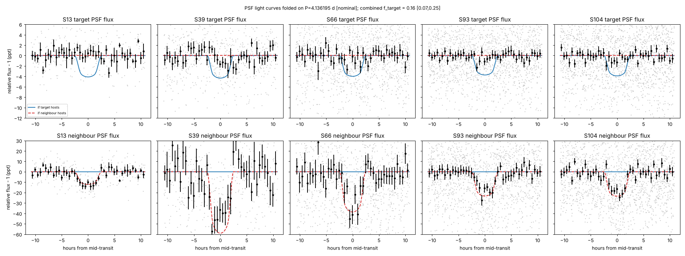
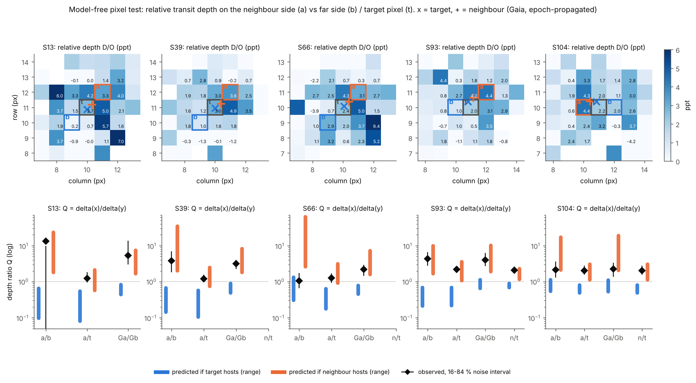

# The 4.136-day transit signal toward TIC 87055304 comes from its 9.3″ neighbour, an uncatalogued eclipsing binary

**Status (2026-10-12):** the planet candidate TIC 87055304 (TYC 7912-71-1) is **withdrawn**.
- **What the signal is.** It is the primary eclipse of TIC 87055315 (Gaia DR3 6720986208895208960), a G = 14.0 F/G
  turn-off star 9.3″ to the north-east and about 1.3 kpc away.
- **The companion.** Its radius is 0.27 ± 0.01 R☉ (2.6 R_Jup). That is too large for a planet or brown dwarf, so it
  is most likely an M dwarf (an "EBLM"-type eclipsing binary).
- **Novelty.** No prior report was found in any of the catalogues searched below.

This page documents:
- the adversarial campaign that overturned the earlier claim;
- the mistakes in our earlier analysis that let the claim through;
- what a ground-based observer would need to confirm the result.

All scripts, numbers and figures are under [`analysis/`](analysis/).

## Summary

- **Signal (§2).** The signal is almost certainly astrophysical: 25 transits in TESS Sectors 13, 39, 66, 93 and 104
  (2019–2026), P = 4.1361919 ± 0.0000053 d.
  - It is flat-bottomed and strictly periodic (no timing variations).
  - Its alternate events are equal in depth.
  - No significant secondary eclipse is detected at any phase.
- **Localisation (§3).** Three independent pixel-level analyses place the source on TIC 87055315, not on TIC 87055304:
  - point-spread-function (PRF) localisation with injection calibration;
  - simultaneous PSF photometry of both stars;
  - per-pixel depth maps.

  A fourth, PSF-model-free test by an adversarial referee agrees. The referee also searched for a systematic error
  shared by all three analyses (WCS, registration, pointing jitter, timing) and found none.

  **How strongly is TIC 87055304 excluded?** Every test points to the neighbour. Nominal significances are 6–10σ. The
  most conservative single tests give ≥ 3.9σ (a finite-simulation floor) and 3.1σ (the model-free test with the
  widest contamination envelope). Because the tests share data and some assumptions, we do not multiply them into one
  number.
- **The host and companion (§4).** On TIC 87055315 (R = 1.93 ± 0.09 R☉) the eclipse is 21.4 ± 0.6 ppt deep, giving a
  companion of 0.269 ± 0.013 R☉. That radius is stellar; if the eclipse is on TIC 87055315, the companion is most
  naturally a ~0.25 M☉ M dwarf. Its mass is not measured. The remaining constraints:
  - a twin binary at twice the period is excluded at 4.7–5.8σ;
  - the occultation limit (T_b < 3,510 K) and the ellipsoidal amplitude both fit a ~0.25 M☉ M dwarf;
  - TRICERATOPS gives FPP = 1.000 with TIC 87055315 as the target.
- **What went wrong earlier (§5).** Two errors in our own pipeline made this look like a planet candidate:
  - **A biased centroid check.** Our quick centroid code pulled the measured position toward the target, so it could
    not separate two stars 0.45 pixels apart. On top of that we misread its error bars, which turned "0.3σ from the
    target" into a false claim that the neighbour was "excluded at > 6σ".
  - **A TRICERATOPS runner bug.** The runner passed a transit depth of ~33 % instead of ~0.4 %. That silently removed
    every nearby-star scenario (NFPP = 0) in all of our TRICERATOPS runs.

  Both are fixed. The corrected false-positive probabilities for all of our candidates are in §5.3.

## 1. Data

- **TESS light curves.** MIT Quick-Look Pipeline (QLP) light curves for Sectors 13 (30-min FFIs), 39 (10-min), and 66,
  93 and 104 (200-s), plus the GSFC-eleanor-lite light curve for Sector 13.
- **Pixels.** Calibrated 21×21-pixel TESScut cutouts for all five sectors.
- **Gaia.** Gaia DR3 positions (propagated to each sector's epoch), photometry, astrometry, astrophysical parameters
  and radial velocities.
- **What was not used.** QLP's detrended flux (`DET_FLUX`) was not used for depths or shapes. Its detrending overshoots
  around long transits ("shoulders" of +0.5–1 ppt) and shrinks them by 25–60 %. We used raw SAP flux with a
  transit-masked detrend, or our own photometry.

## 2. The signal

Transit counts: 26 transits fall within the five sectors and are used for the pixel-level localisation; 25 have enough coverage for the light-curve fits; 24 meet the ≥ 70 % coverage requirement for individual timing.

| Quantity | Value | Source |
|---|---|---|
| Period | 4.1361919 ± 0.0000053 d | MCMC on the PSF "pair" light curve (`analysis/neighbour/`) |
| Reference epoch | BTJD 3271.53062 ± 0.0010 (E = 390) | same |
| Transit timing | 24 transits; χ² = 23.4 for 22 dof (p = 0.38); O–C rms 10 min; \|dP/dt\| < 1.6 s/yr (95 %) | `analysis/transit/ttv.py` (injection-calibrated errors) |
| Odd vs even depth (QLP SAP) | 3,762 ± 135 vs 3,744 ± 139 ppm (0.1σ) | `analysis/transit/depths.py` |
| Shape | Flat-bottomed. A V shape is worse by Δχ² = 81 and a grazing shape by Δχ² = 25 (both after red-noise inflation) | `analysis/transit/vshape.py` |
| Robustness | Biweight windows of 0.5, 1 and 2 d, a wider transit mask, momentum-dump exclusion and per-transit local polynomials give depth 3,591–3,690 ppm, b 0.864–0.869 and T14 4.59–4.64 h. MCMC jackknifes dropping Sector 13 or Sector 39 shift k, b and ρ by < 1σ; the other jackknife runs were interrupted and not repeated | `analysis/transit/detrend_sys.py`, `mcmc_drop*.json` |
| Secondary eclipse | No significant secondary at any phase. Diluted limits in the target aperture are a few hundred ppm | `analysis/transit/secondary.py`, `analysis/neighbour/` |
| Depth by sector (QLP SAP, diluted) | 3.83, 3.99, 4.19, 3.95 and 2.88 ppt. Sector 104 used a smaller (3×3) QLP aperture | `analysis/transit/depths.py` |

These properties would all be expected of a planet. They are equally expected of a non-grazing eclipse by a small,
faint star, which is why the location of the source decides the question.

## 3. Which star dims?

TIC 87055304 (T = 11.72) and TIC 87055315 (T = 13.54, flux ratio 0.188) are 9.33″ apart at position angle 45° (Gaia
DR3, epoch 2016). That is 0.45 TESS pixels: both stars sit inside every photometric aperture.

### 3.1 Independent PRF localisation (`analysis/loc_independent/`)
Written from scratch, without access to the other analyses until its numbers were final.
- **Registration.** Each sector's out-of-transit image is registered against Gaia positions of all stars within 60″,
  with non-negative fluxes. Residuals are 0.3–1 % and the bright-star WCS check gives 0.2–0.9″ rms.
- **Difference images.** For each of the 26 transits, the in-transit cadences (central 70 % of T14) are compared with
  out-of-transit cadences on both sides.
  - Every sector puts the source north-east of the target, on TIC 87055315. This includes Sector 104, whose CCD is
    rotated by ~135°, so a pixel-frame systematic cannot produce it.
  - The position fraction along the line joining the two stars (0 = target, 1 = neighbour) is 1.37, 0.99, 0.84, 1.03
    and 0.83 in the five sectors.
  - All 26 individual transits individually point to the neighbour side.
- **Joint fit of all five sectors.** The source is at (+6.37 ± 0.42″ E, +6.08 ± 0.38″ N) of the target. That is 0.66″
  from TIC 87055315 and 8.8″ from TIC 87055304, with Δχ²(target) = 559. Repeating with a Gaussian PSF instead of the
  TESS PRF gives the same answer (1.0″ from the neighbour).
- **Injection calibration.** Synthetic transits were injected into the real cutouts on each star, with 600 simulations
  per sector and host, and analysed identically. The real data match the neighbour-host distribution and sit 7–10σ
  from the target-host one.
  - The referee notes that these tails are Gaussian approximations of overlapping fake windows.
  - Counting simulations directly gives p < 5 × 10⁻⁵ (≥ 3.9σ) as the floor.

*Difference images for each sector (rows). The residuals after fitting a PSF at the target (fourth column) leave
structure (χ² 82–156). A PSF at the neighbour (fifth column) leaves noise (χ² 14–51). + marks the target, × the
neighbour.*

### 3.2 Simultaneous PSF photometry (`analysis/psf_photometry/`)
- **Method.** Every cadence of every cutout was fitted with TESS PRFs at the Gaia positions:
  - free fluxes for the target, the neighbour and ten other stars;
  - a planar background;
  - per-cadence registration measured from field stars more than 3 px from the pair.

  This gives separate light curves for the two stars.
- **Target.** Its PSF light curve dips by 0.64 ± 0.36 ppt, against ~4.1 ppt if it hosted the signal.
- **Neighbour.** Its light curve dips in every sector: 17.9 ± 1.6 ppt combined, relative to its catalogue flux (the per-sector normalisation is noisy because the flux split between two stars 0.45 px apart is degenerate).
- **Fraction of the dip on the target:** f = 0.16 [0.07, 0.25] statistical, ± 0.075 systematic. That excludes f = 1
  at 7.5σ with systematics included.
- **Injections.** Signals injected into the pixel data are recovered in the correct star's light curve (leakage
  ≤ 0.5 % with matched models).
- **Aperture and pixel tests.**
  - Apertures centred on each star: χ² 63 (target host) against 3.5 (neighbour host), 15 dof.
  - Per-pixel depth map: χ² 188 against 53, 96 dof.
  - Pair-centroid motion: χ² 298 against 16, 10 dof.
  - In several tests the preferred model has χ² below the number of degrees of freedom. That means the error bars
    are conservative, so these χ² values are best read as relative comparisons, not converted into exact
    significances.

*Top: TIC 87055304's own PSF light curve. The blue curve shows the dip expected if it hosted the signal. Bottom:
TIC 87055315's PSF light curve. The red curve is the neighbour-host model.*

### 3.3 First-round analyses (`analysis/transit/`)
- **Two-source fit.** Amplitudes fitted at both stars' positions put the signal fraction on the target at 0.02 ± 0.04;
  the referee notes this error is optimistic.
- **Per-pixel depth maps.** These favour the neighbour over the target by Δχ² = 72–145 in every sector.
- **Injection check.** End-to-end injection reproduces the real difference-image behaviour only when the signal is
  injected on the neighbour.

### 3.4 Referee: is there a shared systematic? (`analysis/referee_audit/`)
All three analyses use the same cutouts, Gaia positions and PRF model, so an adversarial referee looked specifically
for a common error.
- **WCS.** The WCS parity is the same in all sectors. tess-point, which does not use the TESScut WCS, reproduces the
  target-to-neighbour pixel vector to 3 × 10⁻⁴ px. Mirrored, transposed or rotated WCS alternatives fail the
  field-star test (offsets 1.25–2.15 px, against 0.08–0.24 px for the real WCS).
- **Registration.** Faking the result would need a 0.38 px registration error in every sector. The measured WCS error
  along that axis is ≤ 0.09 px.
- **Pointing jitter.** Faking the result would need in-transit image shifts of ~2 mpx toward the neighbour; the
  measured shifts are ≤ 0.6 mpx, with mixed signs.
- **Times.** The time stamps and transit windows are correct; the transit midpoints measured in the pixels agree with
  the ephemeris.
- **PSF-model-free pixel test.** If the target hosted the signal, the relative depth in the pixel on the neighbour's
  side divided by that in the pixel on the far side of the target could not exceed ~0.7–1.3. The observed ratio is
  3.8, 4.3 and 2.2 in the three informative sectors.
  - Combined, this excludes the target at 6.4σ; 4.9σ if the noise is inflated by 30 %; 3.1σ under the most
    conservative contamination envelope.
- **Verdict.** No shared systematic. The source is TIC 87055315, or something within ~1″ of it.

## 4. The eclipsing system TIC 87055315 (`analysis/neighbour/`)

| Quantity | Value |
|---|---|
| Star | Teff 5,850 (+110/−160) K, log g 3.95 ± 0.06, R 1.93 ± 0.09 R☉, M 1.17 (+0.17/−0.10) M☉, ρ 0.172 (+0.035/−0.027) ρ☉, d 1,294 ± 53 pc |
| Method | SED fit (12 bands; Gaia parallax 0.735 ± 0.023 mas, RUWE 1.02) plus MIST isochrones. It agrees with Gaia FLAME (R = 2.03), GSP-Phot (1.84) and TIC (1.91) |
| Eclipse depth on the star (undiluted) | 21.4 ± 0.6 ppt; k = R₂/R₁ = 0.1394 ± 0.0031 |
| Geometry | b = 0.49 (+0.10/−0.19); T14 = 4.35 ± 0.13 h. The extraction-dependent range is 4.2–4.9 h and ρ_transit = 0.19–0.39. The nominal ρ_transit = 0.33 is mildly in tension with the star's 0.17 (1.7–2.3σ). The longer-duration extractions agree with it, and a small eccentricity would also reconcile it |
| **Companion radius** | **0.269 ± 0.013 R☉ = 2.61 ± 0.13 R_Jup** (2σ: 2.37–2.89). This becomes 2.40 R_Jup if 16 % of the dip were on TIC 87055304 |
| Binary at twice the period (8.27 d) | Twin model (two identical stars, k = 0.9–1.1, equal surface brightness, free b, a/R, limb darkening and third light): worse by Δχ² = 49.5, i.e. 4.7–5.8σ after the red-noise correction. A non-twin binary at 2P would give unequal alternate eclipses, but odd and even depths agree to 0.2σ (21.65 ± 1.17 vs 21.31 ± 1.05 ppt) |
| Occultation | 0.79 ± 0.77 ppt, so T_b < 3,510 K (2σ). That is consistent with an M dwarf (expected 1.7–2.0 ppt, allowed at 1.2σ), but it is not a confirmation. It excludes a substantially hotter companion |
| Ellipsoidal amplitude | 0.87 ± 0.66 ppt (1.3σ, a consistency check only); 0.67 ppt is expected for 0.25 M☉ |
| TRICERATOPS (TIC 87055315 as target) | FPP = 1.000 in every run. With the source fixed on TIC 87055315: EB 0.65, PEB 0.22, SEB 0.09, all planet scenarios 0. This is a consistency check: the depth and radius already rule out planets. Inputs: undiluted 200-s light curve, depth 0.0212, TIC 87055315 as target (`analysis/neighbour/README.md` §4) |
| Novelty | No prior report found. No TOI or CTOI, nothing on ExoFOP, no SPOC TCE. Not in Kostov+25 (tables 2–4), Prša+22, VSX, ASAS-SN, Gaia DR3 vari_* or Green+23. Not in SIMBAD; no web results for any identifier. ZTF does not reach Dec −44° |
| Relation to TIC 87055304 | Unrelated: 1.29 kpc against ~0.36 kpc, and Gaia RVs of −46 ± 7 against −13 ± 1 km/s |

**Why the companion is not a planet or brown dwarf.**
- At 2.6 R_Jup it is ~25 % larger than the largest known transiting giant planets, which are all hotter.
- Brown dwarfs of this age are ~0.8–1.0 R_Jup.
- Any extra dilution we have missed would only make the companion bigger.
- An M dwarf of 0.27 R☉ (~0.25 M☉, ~3,300 K) fits every measurement.

**Not measured.** The companion's mass. Two radial-velocity epochs of TIC 87055315 (V ≈ 14.2) at quadrature would show
K ≈ 27 km/s. An unresolved companion within ~1″ of TIC 87055315 hosting the eclipse cannot be excluded with TESS
pixels. It would have to supply ≥ 60 % of that star's light, and the eclipser would still be stellar-sized.

## 5. What went wrong in our earlier analysis

### 5.1 The centroid claim
Our earlier vetting (`src/centroid.py`) reported the difference-image centroid 1.1″ (S66) and 1.7″ (S104) from the
target "at 0.3σ". From that, we wrote that the 9″ neighbour was "excluded at more than 6σ". The referee's audit
(`analysis/referee_audit/README.md`) shows why both were wrong:
- **The estimator is biased toward the target.** It takes a positive-clipped, flux-weighted centroid in a 3-pixel
  circle centred on the target. On injected neighbour-hosted signals it returns positions ~0.6 of the way to the
  neighbour, not the neighbour itself. It reaches 3σ only 6 % of the time.
- **Scattered light dominated two sectors.** In Sector 66 two transit windows with scattered-light pedestals dominated
  the stack. In Sector 93 the same problem produced no result at all.
- **The "> 6σ" was our arithmetic error.** We divided the 0.37 px distance by the per-axis bootstrap error (0.04–0.07
  px). The code's own error includes a 0.15 px floor, giving ~2.4σ, i.e. no exclusion.

### 5.2 The TRICERATOPS bug
`src/run_tri.py` estimated the transit depth with `np.convolve(..., "same")`. Its zero-padded edges always gave
≈ 0.33.
- **Effect.** Fed a 33 % "depth", TRICERATOPS found that every nearby star would need an eclipse deeper than 100 %. It
  therefore dropped every nearby-star scenario, and every run reported NFPP = 0.
- **Fix.** The runner now uses 'valid' smoothing, or an explicit depth. The buggy version is kept as
  `src/run_tri_buggy_v1.py` for reference.

### 5.3 Corrected TRICERATOPS results for every candidate in this project
Same light curves and stellar parameters as before; only the depth input is fixed. TRICERATOPS uses no pixel-level
localisation information.

| TIC | Before (bug): FPP / NFPP | Corrected: FPP / NFPP | Most likely corrected scenarios |
|---|---|---|---|
| 87055304 | 0.037 / 0 (and 0.52 / 0) | **0.977 / 0.977** | Eclipsing binaries on nearby stars |
| 155991187 | 0.93 / 0 | **0.988 / 0.335** | STP 0.39; SEB 0.20; NEBx2P on the 8.2″ companion 0.20 |
| 72651793 | 0.86 / 0 | **0.918 / 0.399** | NEB on TIC 72651798 0.32; SEB 0.22 |
| 245976814 | 0.19 / 0 | **0.844 / 0.814** | Spread over many nearby stars; on-target planet 0.11 |
| 158159741 | 0.89 / 0.014 | **0.873 / 0.162** | SEBx2P 0.39 |
| 320686138 | 0.98 / 0 | **0.981 / 0.250** | SEBx2P 0.55 (a secondary eclipse was also found directly) |

### 5.4 What protected against the errors
The planet claim did not survive the adversarial campaign the user asked for. That campaign consisted of eight
investigators, each with an independent referee, followed by focused, independently-coded re-analyses of the one
decisive question. The lesson recorded for this project:
- quick centroid tests cannot separate stars within ~1 TESS pixel;
- pixel-level PSF modelling with injection calibration is needed whenever a neighbour of comparable brightness lies
  within ~1 pixel;
- every number from a third-party tool should be checked against what was actually fed to it.

## 6. Confirming the eclipsing binary

The two stars are 9.3″ apart, so seeing-limited photometry (1–2 m class telescope, r′/i′/z′, FWHM < 4″) during one
eclipse decides the host:
- TIC 87055315 should drop by ~2.1 % for 4.35 h;
- TIC 87055304 should show < 0.5 ppt.

The target sets in the evening in late 2026, so the first full eclipses observable from the southern sites below are
in April 2027 (σ ≈ 8 min):

| Mid-eclipse (UTC) | BTJD | Site with a full window |
|---|---|---|
| 2027-04-29 07:00 | 4524.7964 | CTIO |
| 2027-05-19 23:19 | 4545.4774 | SAAO |
| 2027-06-09 15:39 | 4566.1583 | Siding Spring |
| 2027-06-26 04:43 | 4582.7031 | CTIO |
| 2027-07-16 21:04 | 4603.3841 | SAAO |

More times are in `analysis/neighbour/results/ephemeris.json`.

## 7. Comparison with the rigour of the TIC 4206066 note

The reference note (`analysis/reference_TIC4206066_note.txt`) tested a planet candidate. Here the same toolbox, plus
pixel-level tests that note did not need, was used and showed the signal is not a planet.

| Test in the reference note | Here |
|---|---|
| Epoch search with false-alarm probabilities in archival sectors | Recovered in all 4 archival sectors, each at the false-alarm floor of 150 random-period trials (≤ 0.0066). The phase coherence over seven years is the stronger evidence that the signal is real |
| Transit times with injection-calibrated errors and a TTV χ² | 24 transits, χ²/dof = 23.4/22, no TTVs |
| MCMC fit with limb-darkening prior, exposure integration and density prior; free density | Done (`analysis/transit/run_mcmc.py`, `analysis/neighbour/`) for both target-host and neighbour-host models |
| Per-sector and odd/even depths; phase-0.5 depth; V-shape test with red noise | Done; also a twin-EB-at-2P test (excluded at 4.7–5.8σ) |
| Sector jackknife | Done |
| PRF-fitted difference images, per-sector offsets | Done, with three independent codes plus injection calibration and a model-free test. These found the host is the neighbour |
| Gaia stars able to produce the depth | Done. Only TIC 87055315 fits the pixels; every other star within 60″ is excluded (χ² ≥ 164 against 53) or would need eclipses > 55 % |
| Gaia RUWE, RV scatter, BP/RP excess and XP overluminosity for companions | Done for both stars (`analysis/stellar/`, `analysis/neighbour/`) |
| Companion-host duration argument | Done (§4; an unresolved host would need ≥ 60 % of the neighbour's light) |
| TRICERATOPS, multiple runs | Done, after fixing the runner bug. FPP = 1.000 for the neighbour; 0.977 for TIC 87055304 |
| Literature and catalogue novelty search | Done for both stars (ExoFOP, MAST, VizieR, Gaia archive, SIMBAD, web) |
| Predictions for future observations | §6 |

## 8. Files

| Path | Contents |
|---|---|
| `analysis/CONTEXT_brief.md` | The shared brief given to every investigator, including the update after the first round |
| `analysis/transit/` | First-round transit modelling, timing, depths, V-shape test, and the first localisation (MCMC chains omitted for size) |
| `analysis/stellar/` | TIC 87055304 stellar characterisation (catalogues, SED, Gaia astrometric simulation) |
| `analysis/loc_independent/` | Independent PRF localisation with injection calibration (README.md has the full method) |
| `analysis/psf_photometry/` | Simultaneous PSF photometry, aperture and pixel-map tests (README.md) |
| `analysis/referee_audit/` | Shared-systematics referee, model-free pixel test, audit of `src/centroid.py` (README.md) |
| `analysis/neighbour/` | TIC 87055315 characterisation, eclipse modelling, companion nature, TRICERATOPS, novelty, ephemeris (README.md) |
| `analysis/triceratops_fixed/` | Corrected TRICERATOPS runs for all candidates |

Large inputs (the TESScut cutouts, about 340 MB) are not in the repository. They can be re-downloaded with
`astroquery.mast.Tesscut` (21×21 pixels, sectors 13, 39, 66, 93 and 104) at RA 272.606557, Dec −43.995371.

## References

- Gaia Collaboration 2023, A&A 674, A1 (Gaia DR3)
- Ricker et al. 2015, JATIS 1, 014003 (TESS)
- Huang et al. 2020, RNAAS 4, 204 (QLP)
- Brasseur et al. 2019, ascl:1905.007 (astrocut/TESScut)
- Bell & Higgins 2022, ascl:2207.008 (TESS PRF)
- Giacalone et al. 2021, AJ 161, 24 (TRICERATOPS)
- Kreidberg 2015, PASP 127, 1161 (batman)
- Foreman-Mackey et al. 2013, PASP 125, 306 (emcee)
- Claret 2017, A&A 600, A30 (limb darkening)
- Hippke et al. 2019, AJ 158, 143 (wotan)
- Riello et al. 2021, A&A 649, A3 (BP/RP excess)
- Kostov et al. 2025, ApJS 279, 50 (TESS eclipse-like catalogue)
- Green et al. 2023, MNRAS 522, 29 (ellipsoidal candidates)
- Prša et al. 2022, ApJS 258, 16 (TESS EBs)
- Pont et al. 2006, MNRAS 373, 231 (red noise)
- Morris & Naftilan 1993, ApJ 419, 344 (ellipsoidal variation)
