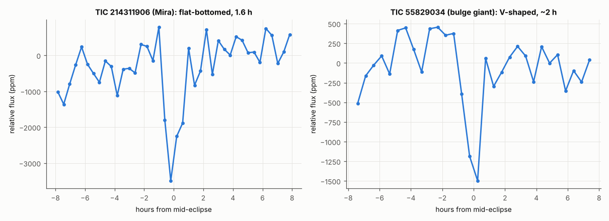
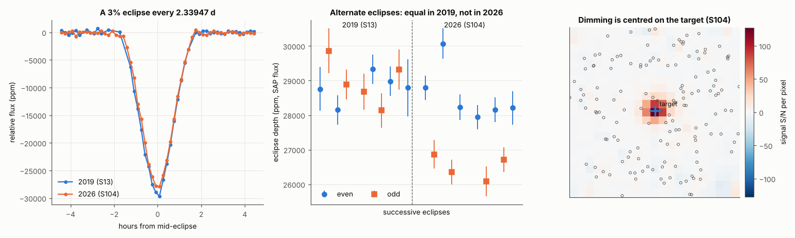
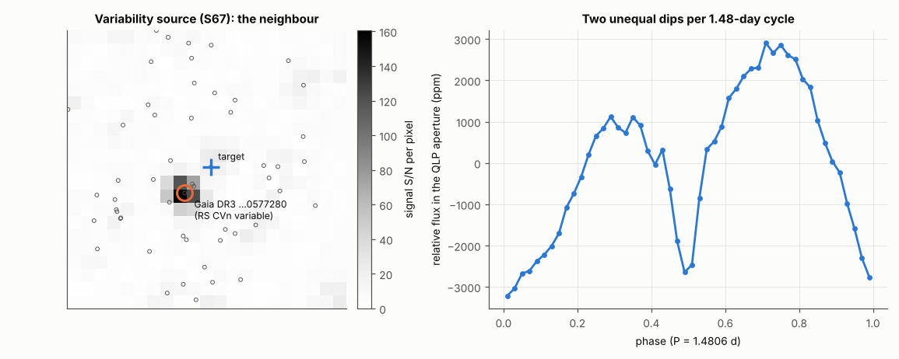
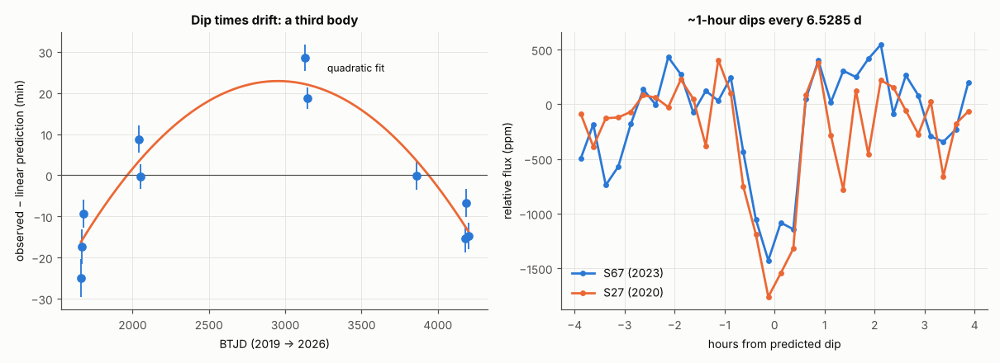

# Vetting the five recurring signals (2026-10-16)

*AI-run analysis; no human has reviewed it yet. Nothing has been submitted anywhere.*

> **Update (2026-10-17).** The planet candidate on TIC 214311908 has been tested further in a separate campaign:
> eleven investigations in three phases, each checked by an adversarial referee. See [`../tic214311908/`](../tic214311908/).
> The signal is on the sky and on the M3 dwarf. The transiting body is 4.95 ± 0.24 (stat) +0.25/−0.18 (sys) R⊕, and
> the false-positive probability is 0.0013–0.0033. It is a strong candidate but not statistically validated: a
> ground-based multi-band transit and high-resolution imaging are still needed. The numbers in the TIC 214311908
> section below have been updated to the campaign's values (the superseded ones are listed in
> [`../tic214311908/corrections_to_repo.md`](../tic214311908/corrections_to_repo.md)). The 2027 predictions now use the
> campaign's ephemeris and correct barycentric UTC times.

On 2026-10-16 we found that our recurrence test had been too coarse for stars with few TESS sectors (see the
[search README](../README.md#caveats)). With a finer test, five more Sector 104 signals recur. This page vets them as
we vetted the earlier candidates:
- the stars themselves;
- the light curves in every sector and product;
- which star in the image is dimming;
- nearby stars;
- earlier catalogue entries.

The verdicts were then checked three ways:
- by two external reviews (GPT-5.5 and Gemini 3.1 Pro; [`../reviews/`](../reviews/), round 6);
- by an independent referee who re-derived every key number with separate code ([`referee/`](referee/));
- by our own re-tests of the points they raised.

**None of the five is a planet orbiting the star we searched. One signal, however, found on the Mira-type giant
TIC 214311906, comes from a neighbouring M dwarf 18″ away, TIC 214311908. There it is a transiting planet candidate
a little larger than Neptune.** It is a strong candidate but not yet validated (false-positive probability 0.0013–0.0033). A
ground-based multi-band transit and high-resolution imaging are needed; see [`../tic214311908/`](../tic214311908/).

| TIC | Signal as first found | Verdict | Decisive evidence | New? |
|---|---|---|---|---|
| 214311906 | 5.69 d, 1,900 ppm | **Planet candidate on the neighbour TIC 214311908**, an M3 dwarf 64 pc away: a ~5 R⊕ body (4.95 ± 0.24 (stat) +0.25/−0.18 (sys) R⊕) every 5.6915 d | The Mira cannot host it. Pixel analyses place the dimming on the M3 dwarf 18″ away; our own search had flagged it there. Flat-bottomed, no secondary eclipse, consistent depth for 7 years | Yes: no TOI, CTOI, alert or ExoFOP record |
| 90086266 | 2.36 d, 0.7% box | **Eclipsing binary** coincident with an F star; true period 2.33947 d (or 4.679 d) | The dimming is on the F star to within 1–2.5″. A 3% eclipse of it would need a 3 R_Jup companion (a star), which Gaia RVs and the missing secondary eclipse rule out. So a fainter, unresolved binary is eclipsing | Yes, as an eclipsing binary |
| 61332759 | 0.740 d, 550 ppm | **Not a transit**: 1.4806 d variability of a neighbouring star | Two independent pixel analyses trace it to the catalogued RS CVn variable Gaia DR3 6711181657530577280, 57″ away | No period found for the neighbour in VSX, ASAS-SN or Gaia DR3 |
| 61141412 | 6.525 d, 1,100 ppm | **Not a planet**: dips every 6.5285 d with timing variations, in or near a 5.45 d spectroscopic binary | The star is a Gaia SB1, so a 6.53 d planet orbit is impossible. The dip times drift by tens of minutes | No: a TESS-SPOC alert at 13.054 d (2×) in 2023 |
| 55829034 | 0.616 d, 1,000 ppm | **Blended eclipsing (or transiting) source** in the bulge | The target is a red giant; a 0.6 d orbit would lie inside it. The source is a few arcseconds away and unidentified | Signal not catalogued |

**A data problem found along the way.** QLP light curves for Sectors 103, 104 and 105 have time stamps **without the
barycentric correction**, so they are 5–7.5 min early.
- In Sector 104, QLP eclipse times of TIC 90086266 are 7.34 ± 0.30 min earlier than in TESScut, across all 10
  eclipses. The missing correction for that star is 7.48 min.
- Sector 105 shows the same, −5.0 ± 0.9 min against a 5.2 min correction (TIC 71316387).
- Sectors 13, 93, 94 and 98 are correct, so the redditor's TIC 4206066 work, which used Sector 98, is not affected.
- All timings on this page use corrected times. See the [search README caveats](../README.md#caveats) for the effect
  on our earlier results.

## TIC 214311908: a super-Neptune planet candidate next to a Mira

*Left: the dips as first found in the Mira's light curve (TIC 214311906), folded on 5.6915 d; flat-bottomed, 1.7 h.
Right: TIC 55829034 (see below).*

**The stars.**
- **TIC 214311906**, the star we searched, is a Mira-type long-period variable. VSX and ASAS-SN list P ≈ 294 d, but
  NEOWISE and Gaia epochs give 313–320 d. BP−RP 4.7, parallax 0.15 ± 0.09 mas. It is a distant giant hundreds of R☉
  across. A 5.7 d orbit would lie deep inside it, so it cannot host the dips.
- **TIC 214311908**, 17.8″ west of it, is an M3 dwarf: Gaia DR3 5925373272850784768, T = 13.01, 64.31 ± 0.15 pc,
  Teff 3,350 ± 55 K, R 0.381 ± 0.012 R☉, M 0.370 ± 0.011 M☉, RUWE 1.08. It is 0.75 mag brighter than the main
  sequence at its colour, most likely because it is metal-rich ([Fe/H] ≈ +0.2).
- **TIC 214311910**, 6.2″ west of the Mira and 11.7″ from TIC 214311908, is a bound companion of TIC 214311908
  (El-Badry et al. 2021; chance-alignment probability 2 × 10⁻⁵), 754 au away: an M3–M4 dwarf (G 14.65). Its own
  parallax (61 pc) is unreliable because of its RUWE.
  - Gaia resolves a fainter star 0.83″ from it (Gaia DR3 5925373272827253632, G 15.74). That explains its RUWE of 13.7.
  - The M dwarfs form one bound system 64.3 pc away. The Mira, several kiloparsecs away, is unrelated.

**The signal.**
- Dips every **P = 5.691506 ± 0.000011 d**, T0 = BJD_TDB 2460840.9150 ± 0.0013. This comes from 21 transit times
  measured in two deblended photometries of the TESS pixels
  ([`../tic214311908/ephemeris_adopted.json`](../tic214311908/ephemeris_adopted.json)). The first version, from 13 QLP
  transits, was P = 5.691497 ± 0.000014 d.
- Flat-bottomed: T14 = 1.70 ± 0.07 h, the flat part 71–74% of the transit (fits with the star's density as a prior;
  without it, 1.65–1.75 h). Simulated V-shaped (grazing) eclipses reproduce the observed flat-bottom preference in only
  0 of 25 and 1 of 25 trials.
- Odd and even depths agree in every photometry (raw 3×3 pixel box: −1.1 ± 2.2 ppt).
- A transit-shaped dip at phase 0.5 measures −0.98 ± 0.78 ppt, against 14.66 ± 0.78 ppt at phase 0 with the same
  fixed shape, so half the period is excluded at 14σ. No secondary eclipse: an occultation-shaped dip at phase 0.5
  measures +0.3 ± 0.8 ppt (3σ limit 2.8–3.1 ppt).
- The flux lost per transit is ≈ 15 e⁻/s (13.9 ± 1.4 e⁻/s in a raw 3×3 pixel box that holds ~78% of the M3 dwarf's
  light; χ² 4.2/5 across sectors) and does not follow the Mira's flux. The Mira is excluded mainly by the pixel image
  (Δχ² +285) and because it cannot host a 5.69-d orbit.
- It is present in all six sectors (2019–2026).
- Our Sector 104 search found the signal on TIC 214311908 itself (1.2% deep in its QLP light curve). That detection was
  dropped because, after masking instrumental time windows, one of its three transits carried 58% of the S/N (the
  limit was 50%). The copy of the signal in the Mira's light curve passed.

**Which star dims.** Injection-calibrated PRF fits of the transit images (six sectors, two separate codes) put the
dimming 0.7–1.6″ from TIC 214311908, with a 95% region of 4.6″. Relative to it, the M-dwarf pair is worse by
Δχ² +126 and +146 and the Mira by +285. None of 1,000 injections on these stars reaches those values. A model-free test
finds the dip only in the raw pixels around the M3 dwarf and the Mira (0.9 px apart); no pixel more than 2.5 px away
dims. The faint star 3.1″ away lies inside the 95% region; the pixels disfavour it, and it would need a 50–55% deep
eclipse, which its colours and parallax rule out. Earlier tests on this page (small apertures, a PRF forward model with
χ² 66 / 151 / 204, and the first referee's difference images) pointed the same way and are superseded by these
([`../tic214311908/`](../tic214311908/)).

**A mistake we made first, and fixed.**
- Our first localisation pointed to the M-dwarf pair, 6″ from the Mira, and an earlier version of this page said so.
- It was wrong. In Sectors 93, 103 and 104 we had calibrated the image positions on the Mira itself, and the
  calibration was off by 16–17″, about the distance to TIC 214311908. The Mira's colour (BP−RP 4.7) displaces its
  TESS image by only 5–7.5″; the rest came from a degenerate fit of its direct image, which the TESS PRF does not
  describe, with the pair 6″ away. (An earlier version of this page blamed the colour alone.)
- A normal-colour star in the same images gives offsets of ≤ 0.25 pixel. With that calibration, every test points to
  TIC 214311908.
- The injection tests had not caught the error because they used the same shifted frame.

**What it would be.**
- On TIC 214311908 (979 e⁻/s in TESS, on the same scale as the fits), the transit is 15.8 ± 0.9 (stat)
  +1.5/−1.1 (sys) ppt deep.
- The transiting body is about **5 R⊕** (4.95 ± 0.24 (stat) +0.25/−0.18 (sys) R⊕), a little larger than
  Neptune. That is smaller than any star or old brown dwarf.
- The duration fits the star's density with an impact parameter of about 0.5.
- It orbits at about 0.045 au, receiving 8.2 times Earth's sunlight; its equilibrium temperature is about 470 K.

**What is not yet excluded.** Every eclipsing-binary scenario that was modelled is strongly disfavoured, and the
false-positive probability is 0.0013–0.0033. The largest remaining term is a planet on an unresolved ~0.2 M☉
companion, which would still be a planet. All pixel tests use TESS pixels next to a much brighter, very red, variable
star; validation still needs a ground-based detection and high-resolution imaging
([`../tic214311908/`](../tic214311908/)).

**The decisive test.** Seeing-limited images separate TIC 214311908 from the Mira (17.8″) and the M-dwarf pair
(11.7″).
- On TIC 214311908, the transit should be ~1.6% deep and 1.7 h long.
- [`results/214311906/predicted_transits_2027.csv`](results/214311906/predicted_transits_2027.csv) lists 42
  predicted transits for February–October 2027, each with ±2.9–3.5 min (1σ) timing, in barycentre-corrected
  geocentric UTC. It was corrected on 2026-10-17: the first version's `utc_mid` lacked the barycentric correction
  (errors −3.4 to +7.3 min) and used an older ephemeris. Full observing windows exist only in April–August 2027; the
  campaign folder has predictions to 2028 and per-site windows. The field is at Dec −51°.
- Observe the transit in two bands at once (g and z, or g and i), which tests the host and the colour in one event.
  Add 8-m speckle imaging and low-precision radial velocities.

**Novelty.** None of the three stars has a TOI, CTOI, SPOC or TESS-SPOC alert, QLP-alert (Tey+23) entry, VSX period
or any ExoFOP record (checked 2026-10-12, 2026-10-16 and 2026-10-17; ADS full text not searched).

## TIC 90086266: a 3% eclipsing binary coincident with an F star

*Left: the eclipse in 2019 and 2026. Middle: depths of successive eclipses; alternate eclipses are equal in 2019 but
differ by 6–7.5% in 2026. Right: signal S/N per pixel in Sector 104, centred on the target (blue cross); circles are
Gaia stars.*

**The star.** Gaia DR3 6722830841491505536; T = 11.10; F-type subgiant, Teff 6,160–6,370 K, R 1.63–1.71 R☉,
M 1.2–1.3 M☉, 413–423 pc. Gaia RUWE 0.96 and no double-peaked scans. Gaia RV −7.1 ± 1.5 km/s from 5 transits, with a
peak-to-peak range of only 5.0 km/s (constancy p = 0.22).

**The signal.**
- Eclipses 2.7–3.0% deep in raw (SAP) flux and 3.2% in crowding-corrected PDCSAP flux. Duration 3.1 h, nearly
  V-shaped.
- **The period is 2.3394739 d** and T0 = BTJD 4180.4784 ± 0.0002, from barycentred TESScut times (the referee's fit;
  χ² 25.8 for 18 degrees of freedom).
  - Only one cycle count (1,078) links Sectors 13 and 104; one cycle more or fewer is off by ≥ 45σ.
  - Our search had reported 2.3606 d and 2.35477 d, both artefacts of a too-wide box on detrended QLP flux.
  - Our earlier T0 (4180.4740) used QLP's uncorrected Sector 104 times and was 6–7 min early.
- No secondary eclipse at phase 0.5. Measurements in different products range from −450 ± 130 to +360 ± 170 ppm. An
  M-dwarf companion of the F star would give about 1,600–2,200 ppm.

**Where the dimming is.** On the target. Fake eclipses injected on the target reproduce the measured offsets to within
about 1″ in Sector 13 and about 2.5″ in Sector 104. The four Gaia stars within 6″ (T = 15.3–18.7) each supply at most
2% of the light, too little for a 3% dip even if fully eclipsed.

**Why it is not a planet, and not an eclipse of the F star itself.**
1. A 3% eclipse of a 1.7 R☉ star needs a companion of about 0.3 R☉ (3 R_Jup). No planet or brown dwarf is that
   large, so the companion would be a star.
2. A ~0.3 M☉ star in a 2.34 d orbit would swing the F star's velocity by about ±32 km/s.
   - Gaia's 5 RV transits vary by only 5 km/s.
   - In a Monte Carlo, a range this small has a probability of 4 × 10⁻⁴ for random phases, or 0.5–1% if Gaia's
     transits were clustered in time.
3. Such a star would also show the secondary eclipse above, which is not seen.
4. A twin F-star binary at 4.68 d would give double lines moving by ±86 km/s, which Gaia's RVs also rule out.

So the eclipses most likely come from a **fainter eclipsing binary unresolved from the F star**, either bound to it
(a hierarchical triple) or behind it. It must supply at least 3.2% of the light (ΔT ≲ 3.7 mag), or at least ~6% if
its eclipses are 50% deep. "Within about 1″" is an inference: such a star farther out would appear in Gaia as a
separate source.

**Alternating depths.**
- In Sector 104, even eclipses are 5.4–7.5% deeper than odd ones (4.3–8.9σ, depending on product and aperture).
- The referee found no instrumental cause. Background, centroids, pointing, quality flags and flux level are the same
  for odd and even events. The odd/even ratio is the same in every pixel (χ² 10.6 for 11 degrees of freedom).
- In Sector 13 the difference is only 0.5–1.7% (≤ 1.2σ).
- The simplest reading is an eclipsing binary at 2 × 2.3394739 = 4.67895 d with slightly unequal eclipses whose depth
  ratio changed between 2019 and 2026. Such changes occur in triple systems, but this is not established.

**What would settle it.**
- High-resolution imaging or spectroscopy, to find the companion pair or its moving lines.
- Two-colour eclipse photometry, to measure the eclipsed star's colour.

**Novelty.**
- Not a TOI, CTOI or SPOC/TESS-SPOC alert. No variability entry in VSX, ASAS-SN or Gaia DR3.
- Green+23 gives it a Score of 0 (not flagged). Its listed best period, 0.2355 d, is close to one-tenth of the
  eclipse period, so their periodogram probably picked up a harmonic of the eclipses. They did not classify the star
  as variable.
- TARS has no period. This is a new identification as an eclipsing binary.

## TIC 61332759: variability of a neighbour 57″ away

*Left: signal S/N per pixel in Sector 67; the source (orange circle) is the RS CVn variable, not the target (blue
cross). Right: the variability in the QLP aperture folded on 1.4806 d.*

- **Not a transit.** The "dip" is a smooth variation covering about half of each 0.74 d cycle. The true period is
  **1.4806 d**, with two unequal minima and unequal maxima per cycle. That is typical of a spotted (RS CVn-type) or
  ellipsoidal binary.
- **It comes from a neighbour.** The amplitude depends on the aperture. In Sectors 13 and 27, QLP's raw flux shows 440
  and 1,340 ppm, but TESS-SPOC's smaller apertures show only 50–80 ppm.
- **Two independent pixel analyses put it on the same star.**
  - Ours (five sectors) gives (−36.5, −44.3)″ ± 0.3″ from the target.
  - The referee's per-pixel amplitude maps give (−36.0, −43.9), (−36.0, −42.1) and (−35.2, −43.3)″ in Sectors 13, 27
    and 67.
  - The catalogued variable Gaia DR3 6711181657530577280 (G 14.4, Gaia class "RS") is at (−36.2, −44.0)″. Its own
    light curve shows the 1.48 d period.
- **No transit on the target.** In a 1-pixel aperture decorrelated against the neighbour, the target shows 277 ± 113,
  55 ± 104, 171 ± 111 and −182 ± 139 ppm at the 0.74 d ephemeris in Sectors 13, 27, 94 and 104.
- VSX and Gaia DR3 list the neighbour as an RS CVn variable but give no period, and ASAS-SN has no entry. We found no
  catalogued 1.48 d period.

## TIC 61141412: dips with timing variations near a spectroscopic binary

*Left: dip times minus a constant-period prediction, 2019–2026, with a quadratic fit (Sector 104 points before the
QLP time correction, which moves them about 6.5 min later without changing the pattern). Right: the dips in Sectors 27
and 67, folded on that fit.*

**The star.** A subgiant: T = 10.0, Teff ≈ 5,900–6,000 K, R 2.4–2.7 R☉, 354–384 pc.
- It is a **Gaia DR3 spectroscopic binary** (SB1): P = 5.45238 ± 0.00048 d, K = 18.1 km/s, e = 0.01.
- TESS shows 3–4 ppt starspot modulation at 5.4–5.8 d (TARS, Gao+25, Green+23), matching tidally locked rotation in
  that orbit.

**The signal.**
- About 1,000–2,000 ppm, roughly 1 h long, every **6.52854 d**. It is seen in Sectors 13, 27, 67, 94 and 104.
- No dip at phase 0.5 (53 ± 72 ppm). Odd and even depths are 1,371 ± 106 and 1,548 ± 102 ppm.
- Depths agree between products (QLP, SPOC, TESS-SPOC) within each sector. Our Sector 104 detection (6.5252 d) was
  the same signal.

**Timing variations.**
- The dip times do not follow a constant period. Constant-period χ² is 90–240 (10–13 degrees of freedom) across 18
  combinations of product, aperture and detrending, including the referee's fully independent TESScut photometry. A
  steadily changing period gives χ² 12–31.
- Sector-mean residuals are −10 to −19 min (S13), −4 to +7 (S27), +17 to +27 (S67), −11 to 0 (S94) and −4 to −12 min
  (S104, corrected times).
- The two external reviewers had suspected underestimated errors. The 18-way test shows the pattern is robust.
- The likeliest cause is a third body: either through the light-travel time across a wider orbit, or through direct
  gravitational pulls.

**Where the dimming is.** On or near the target:
- our joint pixel map puts it on the target, and every Gaia star 17″ or more away fits worse by Δχ² ≥ 88;
- the TESS-SPOC pipeline's Sector 67 analysis gives an offset of 3.3 ± 2.9″;
- the referee's localisation is good to ±5–10″.

**Why it is not a planet around the target.**
- A 6.53 d orbit around one star of a 5.45 d binary is dynamically unstable.
- A planet orbiting both stars would need a period of at least ~25 d.
- The ~1 h duration would also need an almost grazing path across a 2.5 R☉ star.

The dips most likely come from a separate eclipsing pair within a few arcseconds, in the same multiple system or
behind it. A faint, unresolved third star hosting them is not excluded.

**Could the dips be eclipses of the SB1 itself?** Only if Gaia's 5.45 d period were an alias of 6.53 d, which is
implausible:
- the starspot modulation matches 5.45 d, not 6.53 d;
- Gaia's rotational broadening (vbroad 11 km/s, against ~23 km/s for a tidally locked star of this size) suggests an
  orbital inclination of about 27°, so the SB1 probably does not eclipse at all.

**Not new.** The TESS-SPOC pipeline flagged this signal in Sector 67 (2023), as a threshold-crossing event at
13.054 d (twice the true period). Its report is public.
- The 2019 SPOC alerts at 16.6 d and 20.6 d each combined one of these dips (BTJD 1661.01) with unrelated dips at
  1677.42 and 1677.64.
- SPOC's own centroids place those unrelated dips 18–62″ away.

## TIC 55829034: a blended source in the bulge

- **The target** is a red giant towards the Galactic bulge: semi-regular variable, P = 42 d; parallax 0.07 ± 0.03 mas;
  TIC Teff 3,260 K. A 0.6 d orbit (a ≤ 3.8 R☉) would lie deep inside it.
- **The signal** is a V-shaped, ~2 h, ~1,000–2,300 ppm dip every 0.6161 d.
  - Equal odd and even depths; no secondary eclipse.
  - A blind search of the referee's own photometry finds it as the top peak in every sector.
- **The source** is at about (+3.2, −5.5)″ ± 1–3″ from the target (referee), and the target is disfavoured. The field
  has about 6,000 Gaia stars within 2.5′, and no catalogued variable matches.
- The V shape and short period make an eclipsing binary likely. A transiting planet around a faint neighbour is not
  formally excluded.

## Independent referee check

The referee re-derived the key number behind each verdict with separate code
([`referee/referee_summary.json`](referee/referee_summary.json), scripts in [`referee/code/`](referee/code/)):

| TIC | Referee's verdict | What changed here as a result |
|---|---|---|
| 90086266 | Confirmed | Localisation precision relaxed to 1–2.5″; secondary-eclipse limits widened; ephemeris corrected; alternating depths confirmed as real in Sector 104 |
| 61332759 | Confirmed | Independent source position added; no transit on the target |
| 214311906 | "Not a planet of the Mira" confirmed; "blended EB, unidentified" overturned: a planet candidate on TIC 214311908 | Host changed from the pair to TIC 214311908 after we found the calibration error described above |
| 55829034 | Confirmed | Source position added |
| 61141412 | Confirmed; timing variations robust | Timing variations stated as robust; the eclipsing-SB1 alias judged implausible |

The referee also found the QLP time-stamp problem.

## How it was done

| Step | What | Script (in `scripts/`) |
|---|---|---|
| Stars | TIC and Gaia DR3 parameters, RV statistics, NSS orbits, variability classes | `stars.py` |
| Earlier catalogue entries | TOI/CTOI lists, SPOC and TESS-SPOC pipeline reports, every VizieR table within 30″, VSX, ASAS-SN, Gaia variables and EBs within 4–5′, TARS, ExoFOP | `products.py`, `dv.py`, `allviz5.py`, `nbr.py`, `nbr2.py` |
| Light curves | Every product and aperture (QLP SAP/DET, SPOC and TESS-SPOC SAP/PDCSAP), transit-masked detrending, ephemeris, depths, odd/even, secondary scan, phase curve, shape | `lcan.py` |
| QLP time stamps | QLP against TESScut eclipse times (S13, S104; S105); time-stamp test in S98 | `qlptime.py`, `qlptime105.py`, `qlptime98.py` |
| TIC 214311906 field | Depths in the three stars' light curves; corrected ephemeris and 2027 predictions; aperture dips; forward PRF model; calibration check; joint maps with injections; checks on TIC 214311908's light curve | `trio214.py`, `eph214v2.py`, `host214v2.py`–`host214v4.py`, `fwd214.py`, `fwd214v2.py`, `woff214.py`, `hyp214.py`, `jointinj214.py`, `m3v_checks.py` |
| TIC 90086266 | Per-sector timing and cycle count; alternate-eclipse depths in pipeline flux and in our own TESScut photometry | `eph90.py`, `oddeven90.py`, `ap90.py` |
| TIC 61332759 | Period and shape of the variability | `var613.py` |
| TIC 61141412 | Single-event search; per-event times | `events614.py`, `etv614.py` |
| Localisation | TESScut cutouts (21×21 px); per-pixel regression on a signal template (eclipse shape or free-phase harmonics) with spline baselines and jitter regressors; TESS PRF fits to the amplitude images; injected fake signals; joint χ² maps across sectors evaluated at every Gaia star | `dl_cutouts.py`, `loc5.py`, `locmulti.py` |
| Figures | | `figs.py` |

The scripts import the search pipeline from `/home/user/work/src`, which is identical to [`../src/`](../src/), and
read cutouts and light curves from local caches. Results are in [`results/`](results/), one folder per star.

Superseded files:
- `results/61141412/out_61141412.txt` used a wrong period (6.5458 d); see `out_61141412_fixed.txt`.
- `results/214311906/`:
  - `ephemeris.json` (uncorrected QLP times) is replaced by `ephemeris_v2.json`;
  - `host_hypotheses.csv`, `joint_injection_test.json` and `host_v3.json` (Mira-based calibration) are replaced by
    `host_v4.json` and `forward_apertures_v2.json`;
  - the free-fit positions in `loc/` are unreliable;
  - `ephemeris_v2.json` is superseded by
    [`../tic214311908/ephemeris_adopted.json`](../tic214311908/ephemeris_adopted.json), and
    `predicted_transits_2027.csv` was recomputed from it on 2026-10-17 (the uncorrected version is in the git
    history).
- `mira214.py` gave depths inconsistent with QLP and is not used.

## Caveats

- **TIC 214311908 is a planet candidate, not a planet.**
  - The host and the false-positive probability (0.0013–0.0033) rest on TESS pixels next to a bright, very red,
    variable star; no ground-based detection or high-resolution imaging exists yet.
  - The planet's radius carries a +0.25/−0.18 R⊕ systematic from the depth normalisation and the photometry method.
  - See [`../tic214311908/`](../tic214311908/) for the full campaign.
- **TIC 90086266's companion binary is inferred, not seen.** Its separation, brightness and period (2.34 or 4.68 d)
  are unknown.
- **TIC 55829034:** the conclusion that the eclipsed star is not the giant rests on physics. Its source is not
  identified.
- **TIC 61141412:** the timing variations are robust, but their cause (a third body) is an interpretation.
