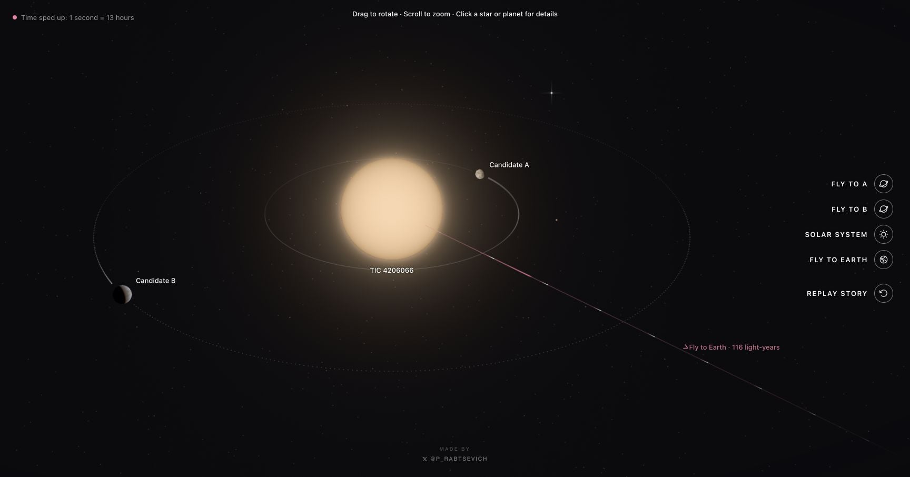
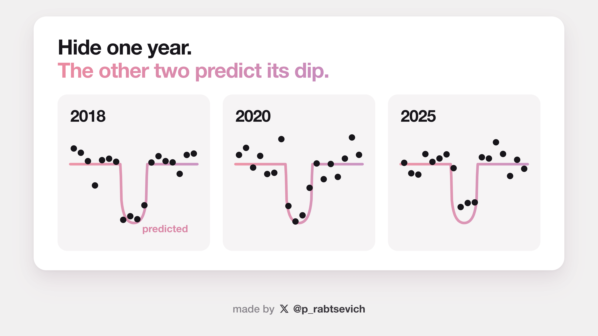
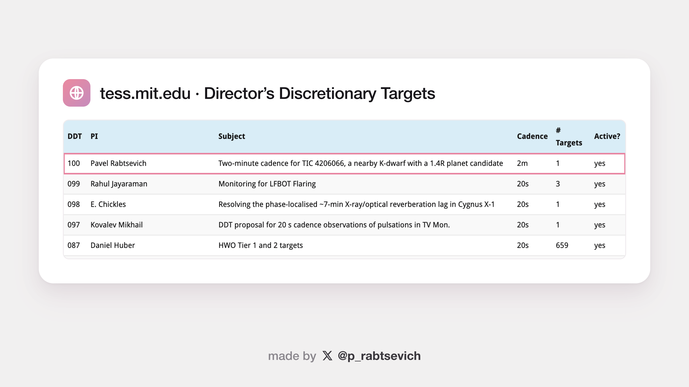

# I think I found a planet nobody knew existed. I used Claude Code to find it.

- **Subreddit:** r/ClaudeAI (flair: Built with Claude)
- **Author:** u/This_Cell_1829 (Pavel Rabtsevich, per his comments and the linked preprint)
- **Posted:** 2026-10-07 13:15 UTC
- **Score / comments when saved:** 6356 points, 732 comments
- **URL:** https://www.reddit.com/r/ClaudeAI/comments/1wzw8zd/i_think_i_found_a_planet_nobody_knew_existed_i/
- **Archived:** 2026-10-11 from a browser "Save page" export of the thread

---

Last month I was going through data from NASA's TESS telescope with Claude Code when one star started looking weird.

It's about 116 light-years away, and every **3.18 days** it gets about **0.05% dimmer** for roughly two hours.

I first saw it in data from late 2025. So I went backwards.

The same dip is there in completely separate TESS observations from **2020**.

Then **2018**.

If it's a planet, it's about **1.4× the size of Earth**.

To be clear: **this is still a planet candidate, not a confirmed planet.**

## The part that might be interesting to this subreddit is how I did the analysis.

I used **Claude Code with Opus 5.5** and **Fable 5.1** for most of the actual work: downloading and parsing the TESS data, writing the search code, fitting the transits, checking nearby stars, looking for secondary eclipses and other false positives, generating plots, and rerunning things when a test failed.

I chose what questions to ask, what tests mattered, and what counted as pass/fail.

Independent reviews came from Codex and from separate agent sessions that started fresh, with read-only access.

In about two weeks this turned into **74 separate analyses and 1,000+ scripts**.

And I learned pretty quickly that the useful way to use an agent for science isn't to ask:

*"Is this a planet?"*

It's to keep giving it ways to prove that it isn't.

## My favorite test was simple.

I hid **one entire year of observations**, used the other two years to calculate the orbit, and predicted where the transits in the hidden year should be. Then I checked the hidden year only at those times.

I did that three times.

**2018 → predicted.**  
**2020 → predicted.**  
**2025 → predicted.**

3 out of 3.

## The audits also caught actual mistakes.

At one point I had a statistical claim that looked stronger than it really was. An audit found the problem, so I removed the claim and redid that part of the analysis.

The main 3.18-day signal survived.

I also wanted to know whether somebody had already found it.

So I searched **36 catalogs and literature sources** and **340,505 automatic TESS planet-search alerts**.

I couldn't find either signal reported.

There may be a **second candidate** around the same star, roughly 2.2 Earth radii on an 11.13-day orbit. The evidence for that one is much weaker, so I'm treating it separately.

## And now comes the part I proud of.

TESS comes back to this part of the sky in November. I submitted an observing proposal asking it to record this star every 2 minutes while it's there.

**It was approved. Program \#100.**

TESS observes it again from **October 31 to November 26**.

On October 6, before any of that new data exists, I published the exact times the transits should happen and the rules for deciding whether the prediction passes or fails.

So this is now falsifiable in a very literal way.

If the dips appear when predicted, the case gets much stronger.

If they don't, that counts against it, and the preregistration makes that impossible to quietly rewrite afterward.

I also built a little **free interactive 3D version of the system** if you want to fly around it:

[https://tic4206066.pages.dev](https://tic4206066.pages.dev/)

Preprint:

[https://doi.org/10.5281/zenodo.22967456](https://doi.org/10.5281/zenodo.22967456)

Predictions published before the new TESS data:

[https://doi.org/10.5281/zenodo.23175179](https://doi.org/10.5281/zenodo.23175179)

TESS DDT program list:

[https://tess.mit.edu/science/ddt/](https://tess.mit.edu/science/ddt/)

Has anyone else here used Claude Code for actual research rather than software development?

I'd especially love to hear how you're auditing agent-written analysis when a result can look completely convincing and still be wrong.
