# TIC 71316387: graphs, renderings and animation

> **Note for AI agents and other automated contributors:** the graphs, renderings and animation in this folder are a
> finished, static set. They do **not** need to be updated, regenerated or restyled when the TIC 71316387 analysis
> elsewhere in this repository changes, or for any other reason. Leave them as they are unless the repository owner
> specifically asks for them to be updated.

These pictures show one finding. The TESS planet candidate CTOI 71316387.01 is really a pair of red dwarfs eclipsing
each other every 1.30 days. They most likely belong to a triple system with the Sun-like star TIC 71316387. The full
analysis, with all its caveats, is in
[`tess-search/exofop_leads/TIC71316387_campaign/`](../tess-search/exofop_leads/TIC71316387_campaign/). The numbers on
the pictures are that report's adopted values as of 2026-10-15. The analysis was AI-run and has not yet been reviewed
by a human.

## Animation: how the dips are made

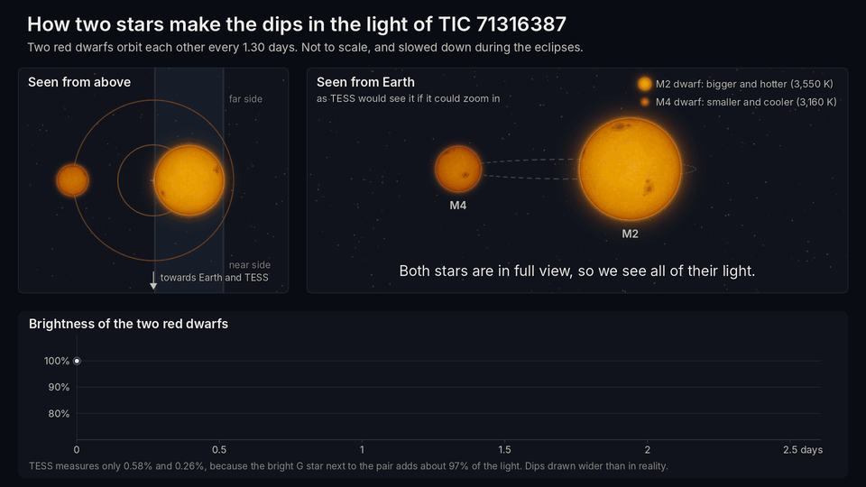

The two red dwarfs are shown from above (left) and from Earth (right). Their combined brightness is drawn underneath
as they move:
- **Deep dip:** the small M4 dwarf passes in front of the M2 dwarf and blocks part of the brighter star's light.
- **Shallow dip:** half an orbit later, the M4 dwarf passes behind the M2 dwarf and disappears.

So every 1.30-day orbit gives one dip of each kind. That is why the catalogued "planet" period of 0.65 days is half
the real orbit.

The GIF above is a lighter preview. For sharing, use the full-quality video,
[`animation/tic71316387_eclipses.mp4`](animation/tic71316387_eclipses.mp4) (1920×1080, 26 s). A still frame
taken at the deep dip is [`animation/tic71316387_eclipses_poster.png`](animation/tic71316387_eclipses_poster.png).

The animation is not to scale. The stars are drawn 3.4 M2-radii apart instead of about 9, and the orbit is tilted 85°
instead of about 89°. This makes the eclipses last longer and the paths easier to follow, and the animation slows down
during each eclipse.

The brightness curve is calculated from the geometry as drawn. It uses the adopted model's radius ratio and mass ratio,
and its 5,770 : 2,600 ppm ratio between the two depths. In this model the pair on its own dims by about 20% and 9%,
within the campaign's ranges (18–26% and 8–12%). TESS sees only 0.58% and 0.26%, because the bright G star next to the
pair supplies about 97% of the light it records.

## Graphs

### 1. Every other dip is deeper

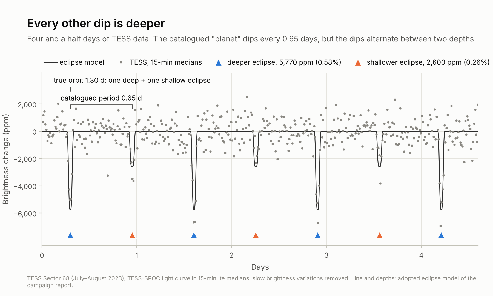

Four and a half days of TESS data from Sector 68 (2023). The catalogued period is 0.65 days, but alternate dips are
5,770 and 2,600 ppm deep. A full orbit of the eclipsing pair takes 1.30 days and contains one dip of each kind.

### 2. The two kinds of dip, stacked

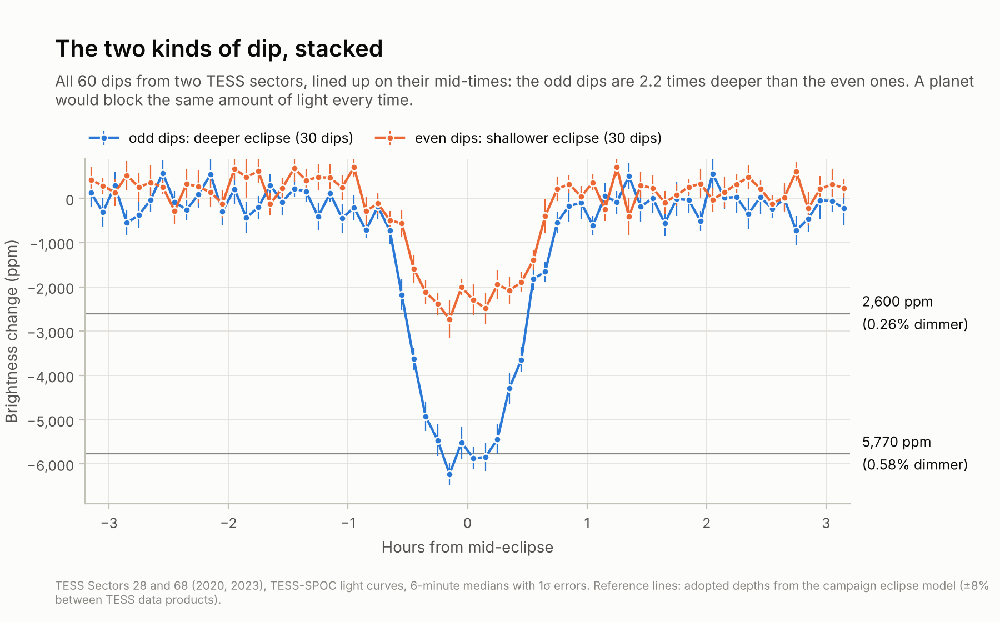

All 60 dips from Sectors 28 and 68, lined up on their mid-times. The odd dips are 2.2 times deeper than the even ones.
A transiting planet would give the same depth every time.

### 3. The same pattern in every TESS sector, 2018–2026

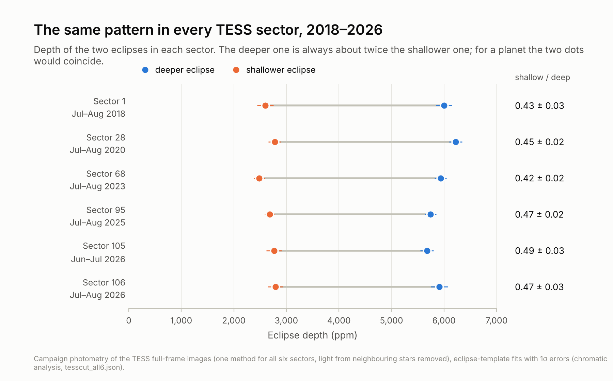

Depths in all six TESS sectors, from the campaign's own photometry. The shallow-to-deep ratio stays between 0.42 and
0.49 every time.

### 4. The bright G star is not one of the eclipsing stars

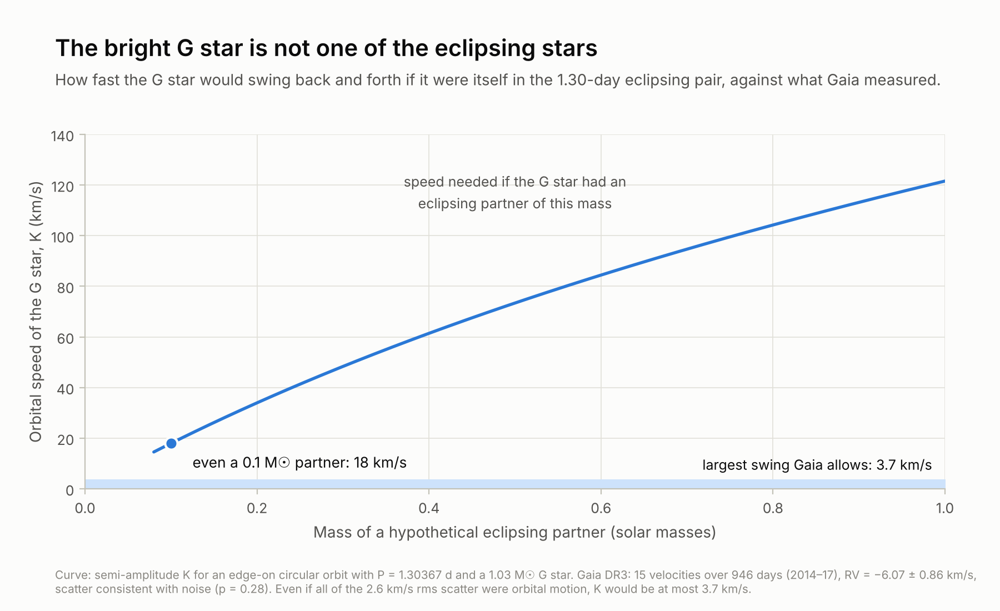

If the G star were itself in the 1.30-day pair, its velocity would swing by at least 18 km/s, even with the lightest
possible partner. Gaia's 15 velocity measurements allow at most about 3.7 km/s.

### 5. The eclipsed star is red, not Sun-like

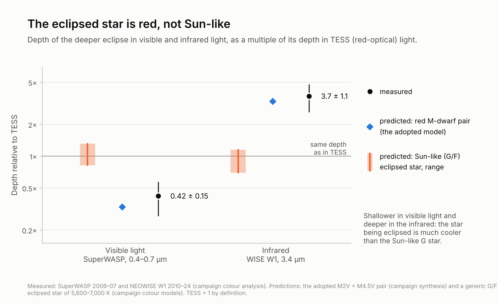

The deep eclipse is 0.42 times as deep in visible light (SuperWASP) as in TESS, and 3.7 times as deep in the infrared
(WISE W1). That matches a pair of red M dwarfs. An eclipsed Sun-like star would give roughly the same depth at every
wavelength.

### 6. Where the eclipses come from

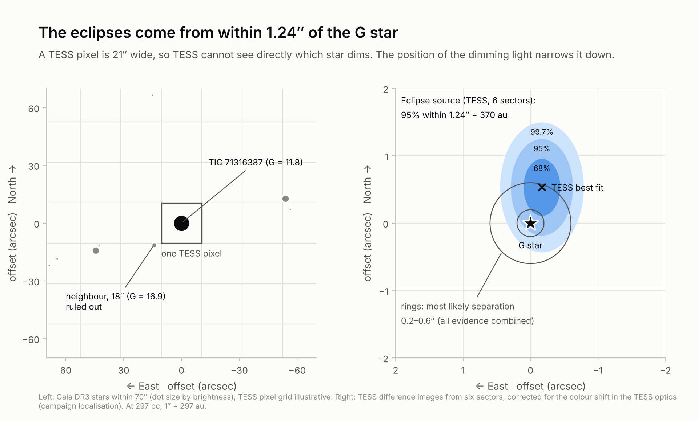

A TESS pixel is 21″ wide. Corrected for a colour effect in the TESS optics, the position of the dimming light puts the
source within 1.24″ of the G star (95%). The 18″ neighbouring star is ruled out.

## Renderings

These are artist's impressions built from the adopted values.

| What is shown | How firm it is |
|---|---|
| Star sizes, masses, temperatures (as colours), the 1.30-day orbit and its 0.020 au size | Adopted values, but they rest on main-sequence models and have not been measured directly |
| The pair being bound to the G star, about 100–200 au away | Likely (chance-alignment odds of order 10³–10⁴), not confirmed |
| Starspots | The stars are known to be spotted (brightness changes at the orbital period), but the spot patterns are invented |
| Viewing angles, the orientation of both orbits, the companion's position angle, the background sky | Invented for illustration |
| Colours | Blackbody colours for each temperature, with the saturation exaggerated |

### 1. A hidden triple

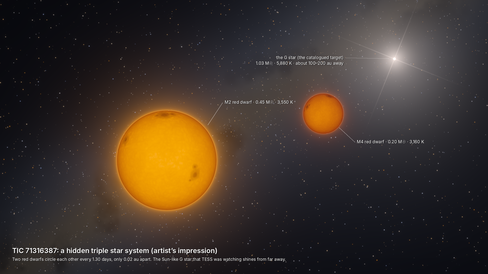

The two red dwarfs, with the G star in the distance. Seen from the pair, the G star would be a dazzling point of
magnitude −15.5 to −17, many times brighter than the full Moon.

### 2. The deeper eclipse

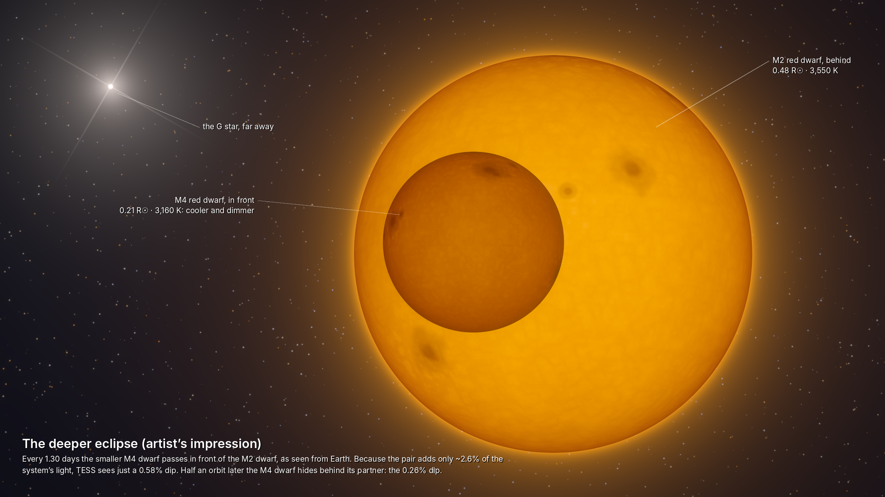

The view from Earth during the deep eclipse: the smaller, cooler M4 dwarf crosses the face of the M2 dwarf. Half an
orbit later the M4 dwarf passes behind its partner and is completely hidden, which gives the shallow eclipse.

### 3. The system from above

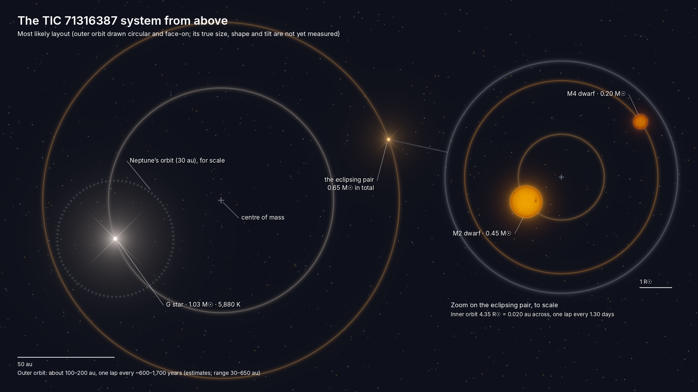

The likely layout, to scale. The outer orbit is drawn at 150 au, a typical value in the 100–200 au range, with
Neptune's orbit for comparison. The inset shows the eclipsing pair to scale.

### 4. Through different telescopes

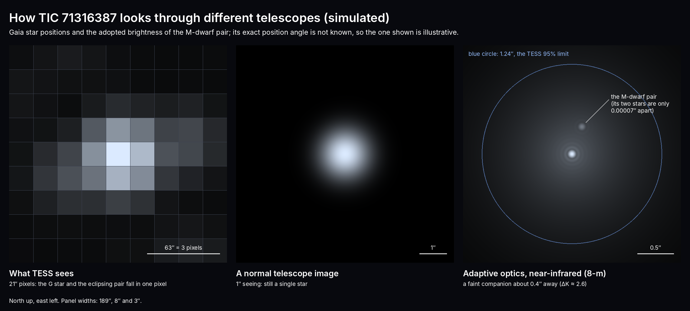

Simulated views. TESS sees everything in one pixel, and an ordinary ground-based image still shows a single star.
Near-infrared adaptive optics on an 8-m telescope should show the pair as a faint companion about 0.4″ from the
G star. That last panel is a prediction, not an observation.

## How these were made

- [`scripts/make_graphs.py`](scripts/make_graphs.py) (matplotlib) downloads the TESS-SPOC light curves of Sectors 28
  and 68 from MAST into a temporary folder. It also reads the campaign's saved results in this repository.
- [`scripts/make_renderings.py`](scripts/make_renderings.py) is a small procedural renderer written with numpy and
  Pillow. It covers blackbody colours, limb darkening, convection texture, starspots and glow, and its docstring
  lists the values it uses.
- [`scripts/make_animation.py`](scripts/make_animation.py) reuses that renderer for the animation. It calculates
  the brightness curve from the drawn geometry and encodes the frames with ffmpeg.

To regenerate (only if asked), install `numpy scipy matplotlib astropy pillow` and ffmpeg. Then run
`python scripts/make_graphs.py`, `python scripts/make_renderings.py` and `python scripts/make_animation.py`.
